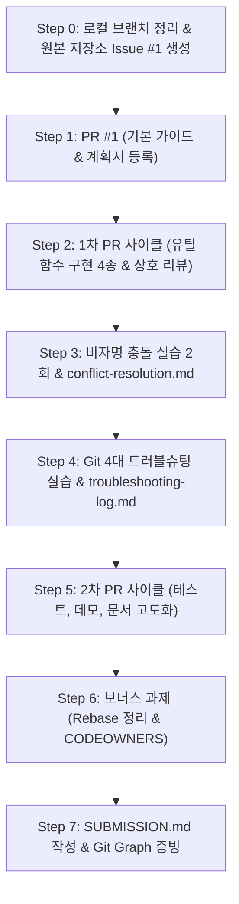

# [실시계획서] Python & Git 심화 협업 미션 실행 런북 (b2_2_action_plan)

> **목적**: [docs/b2_2_mission.md](file:///Users/mpeg46551/codyssey2026-B2-2/docs/b2_2_mission.md)의 모든 요구사항(필수 10종, 보너스 2종, 평가문항)을 빈틈없이 수행하기 위한 실무 런북(Runbook).  
> **팀원 4인**: **이진걸(팀 리드)**, **송근영**, **김동조**, **민병우**  
> **저장소 구조**:
> - 최종 원본 저장소 (Upstream): [https://github.com/I-nkamanda/codyssey2026-B2-2](https://github.com/I-nkamanda/codyssey2026-B2-2)
> - 포크 작업 저장소 (Origin): [https://github.com/nttkor/codyssey2026-B2-2](https://github.com/nttkor/codyssey2026-B2-2)

---

## 📊 1. 팀원별 필수 정량 지표 할당표

| 팀원 | 담당 유틸 모듈 | 1차 PR (기능/문서) | 2차 PR (고도화/테스트) | 코드 리뷰 담당 (최소 2회) | 트러블슈팅 담당 |
| :--- | :--- | :--- | :--- | :--- | :--- |
| **이진걸** | `string_utils.py` | PR #2 (문자열 유틸) | PR #6 (단위 테스트) | PR #1, PR #5 리뷰 | 시나리오 a (`amend`) |
| **송근영** | `math_utils.py` | PR #3 (수학 유틸) | PR #7 (문서 통합) | PR #2, PR #6 리뷰 | 시나리오 b (`reset --soft`) |
| **김동조** | 협업 기반 & `date_utils.py` | PR #1 (기반 문서/계획), PR #4 (날짜 유틸) | - | PR #3, PR #8 리뷰 | 시나리오 c (`revert`) |
| **민병우** | `validation_utils.py` | PR #5 (검증 유틸) | PR #8 (CLI 데모) | PR #4, PR #7 리뷰 | 시나리오 d (`stash/pop`) |

---

## 🛠️ 2. 단계별 실행 계획 (Phase 0 ~ Phase 7)



---

### Step 0: 로컬 브랜치 분리 및 Upstream Issue #1 생성

1. **GitHub 웹(Upstream)에서 Issue #1 생성**
   - 대상: [I-nkamanda/codyssey2026-B2-2](https://github.com/I-nkamanda/codyssey2026-B2-2)
   - 제목: `[Docs] 프로젝트 기본 설정 및 협업 실행 계획 수립`
   - 본문:
     ```markdown
     ## 작업 목적
     팀 협업의 기초가 되는 .gitignore, 미션/평가 마크다운, 팀 실행계획을 저장소에 반영합니다.

     ## 세부 작업 내용
     - [ ] .gitignore 파일 설정
     - [ ] docs/b2_2_mission.md, docs/b2_2_Eval.md 마크다운 변환
     - [ ] docs/b2_2_basic_plan.md, docs/b2_2_action_plan.md 수립
     ```

2. **로컬 터미널에서 기존 커밋을 브랜치로 분리하고 main 초기화**
   ```bash
   # 1. 지금까지 작업한 커밋들을 feature/1-djkim-setup 브랜치로 보존
   git branch feature/1-djkim-setup

   # 2. main 브랜치를 최초 커밋(9ed1af2)으로 리셋
   git reset --hard 9ed1af2

   # 3. 원격 fork(nttkor)의 main을 최초 상태로 강제 푸시 (깨끗한 main 유지)
   git push origin main --force

   # 4. 작업 브랜치로 이동 후 원격에 푸시
   git checkout feature/1-djkim-setup
   git push -u origin feature/1-djkim-setup
   ```

---

### Step 1: PR #1 생성, 리뷰 및 병합 (김동조 담당)

1. **PR #1 생성 (GitHub 웹)**:
   - Base: `I-nkamanda/codyssey2026-B2-2 (main)` ⬅️ Head: `nttkor/codyssey2026-B2-2 (feature/1-djkim-setup)`
   - 제목: `docs: 프로젝트 기본 설정 및 협업 계획 수립 (#1)`
   - 본문:
     ```markdown
     ## 연결 이슈
     - Closes #1

     ## 변경 사항(What)
     - .gitignore 추가 (.DS_Store 등 제외)
     - 미션 및 평가 문서 마크다운 변환(docs/b2_2_mission.md, docs/b2_2_Eval.md)
     - 4인 협업 종합계획서(docs/b2_2_basic_plan.md) 및 상세 실시계획서(docs/b2_2_action_plan.md) 작성

     ## 변경 이유(Why)
     - 협업 워크플로우를 사전에 확립하여 평가 기준을 100% 만족하기 위함

     ## 테스트/검증(How)
     - [x] 로컬 문서 파일 생성 및 정상 동작 확인
     - [x] git status 및 commit 히스토리 검증
     ```
2. **코드 리뷰 (이진걸)**:
   - PR의 `Files changed`에서 실질 코멘트 작성:
     > *"역할 분담과 런북이 상세하게 작성되었습니다. Phase 2 유틸 구현 시 각 함수별 doctest나 타입 힌트를 반드시 포함하도록 규정하면 좋겠습니다."*
3. **피드백 반영 (김동조)**:
   - 코멘트에 답글 작성 후 Approve ➡️ **Merge pull request** 실행.

---

### Step 2: 협업 가이드 확립 (`docs/CONTRIBUTING.md` & PR 템플릿)

- **Issue #2 생성**: `[Docs] 협업 가이드(CONTRIBUTING.md) 및 PR 템플릿 추가`
- **파일 생성**:
  - `docs/CONTRIBUTING.md`: GitHub Flow 규칙, 브랜치 네이밍, 커밋 컨벤션, 코드리뷰 규칙, 충돌 해결 절차 명시
  - `.github/PULL_REQUEST_TEMPLATE.md`: PR 열 때 자동으로 What/Why/How 입력창에 채워지는 템플릿

---

### Step 3: 1차 PR 사이클 - Python 유틸리티 모듈 분담 개발

> 각 팀원은 반드시 **[Issue 생성] ➡️ [feature 브랜치 분기] ➡️ [코드 작성/커밋] ➡️ [PR 생성 (`Closes #n`)] ➡️ [리뷰어의 라인 코멘트] ➡️ [피드백 반영 커밋] ➡️ [Approve & Merge]** 사이클을 따릅니다.

1. **이진걸 (Issue #3 ➡️ PR #2)**:
   - 모듈: `src/utils/string_utils.py`
   - 구현 함수: `slugify(text)`, `truncate(text, max_len)`, `camel_to_snake(text)`
   - 브랜치: `feature/3-string-utils`
   - 리뷰어: **송근영** (피드백: 예외 입력값 처리 질문) ➡️ 수정 커밋 반영 후 머지

2. **송근영 (Issue #4 ➡️ PR #3)**:
   - 모듈: `src/utils/math_utils.py`
   - 구현 함수: `clamp(value, min_val, max_val)`, `lerp(a, b, t)`, `round_up_to_multiple(n, m)`
   - 브랜치: `feature/4-math-utils`
   - 리뷰어: **김동조** (피드백: 0으로 나누기 방어 로직 제안) ➡️ 수정 커밋 반영 후 머지

3. **김동조 (Issue #5 ➡️ PR #4)**:
   - 모듈: `src/utils/date_utils.py`
   - 구현 함수: `format_relative_time(dt)`, `is_weekend(dt)`, `parse_iso_date(str)`
   - 브랜치: `feature/5-date-utils`
   - 리뷰어: **민병우** (피드백: 타임존 지원 확장 제안) ➡️ 수정 커밋 반영 후 머지

4. **민병우 (Issue #6 ➡️ PR #5)**:
   - 모듈: `src/utils/validation_utils.py`
   - 구현 함수: `is_valid_email(email)`, `is_valid_phone(phone)`, `is_strong_password(pw)`
   - 브랜치: `feature/6-validation-utils`
   - 리뷰어: **이진걸** (피드백: 정규식 경계값 테스트 케이스 질문) ➡️ 수정 커밋 반영 후 머지

---

### Step 4: 충돌 해결 실습 (최소 2회, 비자명 충돌 필수) & `docs/conflict-resolution.md`

#### [실습 1] 비자명 충돌(Non-trivial Conflict) - 동일 Hunk 충돌
- **시나리오**: `src/utils/string_utils.py`의 `slugify()` 함수 내부 정규식 치환 정책을 두 팀원이 동시에 수정
  - 브랜치 1 (`feature/slugify-lowercase`): 영문 소문자 치환 및 공백 대시 변환
  - 브랜치 2 (`feature/slugify-sanitize`): 특수문자 제거 및 언더스코어 변환
- **발생 절차**:
  1. 브랜치 1이 먼저 `main`에 머지됨
  2. 브랜치 2에서 `git merge origin/main` 시 충돌 발생 (`CONFLICT in string_utils.py`)
  3. `<<<<<<< HEAD`, `=======`, `>>>>>>>` 충돌 마커 확인
  4. 양쪽 요구사항을 모두 반영(Keep Both & Refactor)하여 통합 로직으로 수동 수정
  5. `git add` 후 `git commit -m "fix(conflict): resolve slugify logic merge conflict"`
- **문서화**: `docs/conflict-resolution.md`의 [충돌 기록 #1]에 상황, 충돌 마커, 해결 전략, 결과 기록

#### [실습 2] 파일 경로/이름 변경 vs 내용 수정 충돌
- **시나리오**: 한쪽 브랜치에서 모듈 구조를 리팩토링(파일명 변경)하고, 다른 쪽에서 기존 파일에 함수를 추가하여 머지 시 충돌 유발
- **문서화**: `docs/conflict-resolution.md`의 [충돌 기록 #2]에 기록

---

### Step 5: Git 4대 트러블슈팅 실습 & `docs/troubleshooting-log.md`

> 4가지 시나리오를 팀원 4명이 각각 1개씩 전담하여 재현하고 로그를 작성합니다.

1. **시나리오 a: `git commit --amend` (담당: 이진걸)**
   - 재현: 커밋 메시지에 오타가 발생했거나 필수 파일 1개를 누락하고 커밋함
   - 해결: `git add <누락파일>` ➡️ `git commit --amend -m "정상적인 커밋 메시지"`
   - 주의점: 이미 원격에 push된 커밋에는 강제 푸시가 필요하므로 로컬 커밋에서만 사용할 것
2. **시나리오 b: `git reset --soft HEAD~1` (담당: 송근영)**
   - 재현: 로컬에서 너무 성급하게 커밋하여 커밋을 취소하고 다시 스테이징해야 함
   - 해결: `git reset --soft HEAD~1` (작업 트리 및 스테이징 상태는 100% 유지)
   - 주의점: `--hard` 사용 시 변경사항이 유실되므로 안전한 `--soft` 사용
3. **시나리오 c: `git revert <commit_hash>` (담당: 김동조)**
   - 재현: 이미 `main`에 병합 및 원격 푸시된 커밋에 결함이 발견되어 취소해야 함
   - 해결: `git revert <commit_hash>`로 해당 변경을 상쇄하는 새 커밋 생성
   - Why: 원격 공유 브랜치에서 `reset`을 쓰면 타 팀원과의 히스토리가 깨지므로 이력을 남기는 `revert` 필수
4. **시나리오 d: `git stash` / `git stash pop` (담당: 민병우)**
   - 재현: 미완성 작업 중 긴급 버그 수정 요청으로 브랜치를 긴급 전환해야 함
   - 해결: `git stash -u` (임시 보관) ➡️ 핫픽스 처리 ➡️ 복귀 후 `git stash pop`
   - 주의점: stash pop 시 충돌이 나면 stash 목록에서 자동 삭제되지 않으므로 수동 해결 후 `git stash drop`

---

### Step 6: 2차 PR 사이클 (기여도 100% 충족 및 고도화)

1. **이진걸 (PR #6)**: `tests/` 단위 테스트(pytest) 작성 및 README 사용법 추가 (리뷰: 민병우)
2. **송근영 (PR #7)**: `docs/troubleshooting-log.md` 4종 문서 취합 및 서식 정리 (리뷰: 이진걸)
3. **민병우 (PR #8)**: 유틸리티 실행 예시 CLI 스크립트(`src/main.py`) 작성 (리뷰: 김동조)

---

### Step 7: 보너스 과제 수행 (선택)

1. **히스토리 정리 (`git rebase -i`)**:
   - feature 브랜치에서 자잘한 커밋 3~4개를 `squash` 및 `reword`하여 단일 커밋으로 깔끔하게 정리
   - 정리 전/후 `git log` 캡처를 `docs/troubleshooting-log.md` 부록에 추가
2. **리뷰어 자동화 (`.github/CODEOWNERS`)**:
   - 파일별 소유자 지정:
     ```
     * @I-nkamanda
     /docs/ @nttkor
     /src/utils/ @I-nkamanda @nttkor
     ```

---

### Step 8: `SUBMISSION.md` 인덱스 문서 작성 & 최종 검증

1. **`SUBMISSION.md` 작성**:
   - 팀 저장소 URL (`https://github.com/I-nkamanda/codyssey2026-B2-2`)
   - 팀원별 기여도 매트릭스 (PR 링크 8개, 리뷰 링크 8개)
   - 협업 문서 3종 링크 (`CONTRIBUTING.md`, `conflict-resolution.md`, `troubleshooting-log.md`)
   - 최종 `git log --oneline --graph --all` 출력문 첨부
2. **평가 인터뷰 Q&A 치트시트 숙지**:
   - main 상시 배포 이유, revert vs reset, 충돌 마커 원리, GitHub Flow 핫픽스 순서 등 점검
