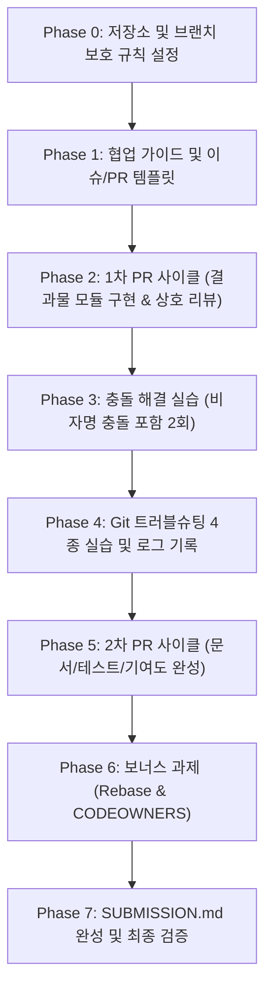

# [Plan] Python & Git 심화 협업 미션 구현 계획서

> **목표**: [docs/b2_2_mission.md](file:///Users/mpeg46551/codyssey2026-B2-2/docs/b2_2_mission.md) 및 [docs/b2_2_Eval.md](file:///Users/mpeg46551/codyssey2026-B2-2/docs/b2_2_Eval.md)의 모든 요구사항(필수 10개 항목 + 보너스 2개 항목 + 평가 구두 질문)을 100% 충족하는 실전 협업 프로젝트 완수

---

## 1. 프로젝트 개요 및 팀 구성

- **저장소**: [I-nkamanda/codyssey2026-B2-2](https://github.com/I-nkamanda/codyssey2026-B2-2) (Fork: [nttkor/codyssey2026-B2-2](https://github.com/nttkor/codyssey2026-B2-2))
- **팀원 (4인)**:
  - **팀원 A (이진걸)**: 팀 리드, 저장소/규칙 세팅, 유틸 함수 Part 1, 트러블슈팅 1 (`amend`)
  - **팀원 B (송근영)**: 협업 가이드 문서화, 유틸 함수 Part 2, 트러블슈팅 2 (`reset --soft`)
  - **팀원 C (김동조)**: 충돌 시나리오 설계 및 해결, 유틸 함수 Part 3, 트러블슈팅 3 (`revert`)
  - **팀원 D (민병우)**: 트러블슈팅 종합 및 검증, 유틸 함수 Part 4, 트러블슈팅 4 (`stash/pop`)
- **선택 결과물**: **(A) Python 유틸 함수 모음 + 단위 테스트** (`src/utils/` 및 `tests/`)

---

## 2. 필수 정량 달성 지표 매트릭스

| 팀원 | PR 생성 및 머지 (최소 2건) | 코드 리뷰 작성 (최소 2건, 본인 PR 제외) | 리뷰 피드백 반영 (최소 1건) | 트러블슈팅 기록 참여 (최소 1건) | 결과물 커밋 기여 (최소 1건) |
| :--- | :--- | :--- | :--- | :--- | :--- |
| **이진걸** | PR #1, PR #5 (2건) | PR #2, PR #6 리뷰 (2건) | PR #1 or #5 반영 완료 | 시나리오 a (`amend`) | 유틸 함수 구현 |
| **송근영** | PR #2, PR #6 (2건) | PR #3, PR #7 리뷰 (2건) | PR #2 or #6 반영 완료 | 시나리오 b (`reset`) | 유틸 함수 구현 |
| **김동조** | PR #3, PR #7 (2건) | PR #4, PR #8 리뷰 (2건) | PR #3 or #7 반영 완료 | 시나리오 c (`revert`) | 유틸 함수 구현 |
| **민병우** | PR #4, PR #8 (2건) | PR #1, PR #5 리뷰 (2건) | PR #4 or #8 반영 완료 | 시나리오 d (`stash`) | 유틸 함수 구현 |

> **팀 전체 최소 기준 요약**:
> - 총 병합 PR 수: **최소 8개 이상**
> - 실질 코드 리뷰 코멘트: **최소 8개 이상 (단순 LGTM 금지, 라인 단위 구체적 코멘트)**
> - 충돌 해결 기록: **최소 2회 (최소 1회 비자명 충돌 필수)**
> - 트러블슈팅 실습: **4종 전체 수행 및 문서화**

---

## 3. 단계별 실행 로드맵 (Phase 0 ~ Phase 7)



---

### Phase 0: 저장소 초기화 및 Branch Protection 설정
- [ ] **팀원 Collaborator 초대 및 쓰기 권한 확인** (모든 팀원 GitHub 계정: 이진걸, 송근영, 김동조, 민병우)
- [ ] **기본 폴더 구조 생성**:
  ```
  codyssey2026-B2-2/
  ├── .github/
  │   ├── ISSUE_TEMPLATE/
  │   │   ├── feature_request.md
  │   │   └── bug_report.md
  │   ├── PULL_REQUEST_TEMPLATE.md
  │   └── CODEOWNERS (보너스)
  ├── docs/
  │   ├── CONTRIBUTING.md
  │   ├── conflict-resolution.md
  │   └── troubleshooting-log.md
  ├── src/
  │   ├── __init__.py
  │   └── utils/
  │       ├── __init__.py
  │       ├── string_utils.py
  │       ├── math_utils.py
  │       ├── date_utils.py
  │       └── validation_utils.py
  ├── tests/
  ├── README.md
  ├── SUBMISSION.md
  └── .gitignore
  ```
- [ ] **GitHub Repository Settings - Branch Protection Rule 적용**:
  - Target branch: `main`
  - `Require a pull request before merging` (체크)
  - `Require approvals`: 최소 **1**명 이상
  - `Dismiss stale pull request approvals when new commits are pushed` (권장)
  - `Require conversation resolution before merging` (권장)
  - `Do not allow bypassing the above settings` (체크 - 관리자도 직접 push 차단)

---

### Phase 1: 협업 가이드 문서 및 템플릿 구축 (`docs/CONTRIBUTING.md`)
- [ ] **Issue #1 생성**: `[Docs] 협업 가이드 및 GitHub Flow 규칙 수립`
- [ ] `docs/CONTRIBUTING.md` 작성 내용:
  1. **브랜치 전략 (GitHub Flow)**:
     - `main`: 항상 배포 가능한 상태(Production-ready)
     - `feature/*`: 작업 단위 브랜치 (`feature/issue-1-contributing-guide`)
     - GitHub Flow 선택 이유 (3줄 요약)
  2. **브랜치 네이밍 규칙**: `feature/<issue_number>-<kebab-case-topic>`
  3. **커밋 메시지 컨벤션**:
     - 형식: `type: subject` (feat, fix, docs, refactor, test, chore)
     - 금지 기준: `update`, `fix`, `temp`, `wip`, `final`, `edit file` 등 단독 사용 엄금
  4. **PR 규칙**:
     - 필수 항목: `변경 사항(What)`, `변경 이유(Why)`, `테스트/검증 방법(How)`, `Closes #이슈번호`
     - 병합 조건: 최소 1인 승인(Approve), 리뷰 코멘트 피드백 반영 완료
  5. **코드 리뷰 규칙**:
     - LGTM만 남기기 금지, 코드 라인 근거 질문/개선 제안 의무화
  6. **충돌 대응 흐름**:
     - 충돌 발생 알림 -> 공동 확인 -> 해결 전략 선택 -> 테스트 -> `conflict-resolution.md` 기록
- [ ] **GitHub PR/Issue 템플릿 설정**:
  - `.github/PULL_REQUEST_TEMPLATE.md` 추가

---

### Phase 2: 1차 PR 사이클 (결과물 모듈 구현 & 실질 코드 리뷰)
> 각 팀원이 본인 담당 모듈을 Issue 생성 후 feature 브랜치에서 작업하고 PR 생성

- [ ] **이진걸 (PR #1)**:
  - Issue: `[Feat] 문자열 처리 유틸 함수(string_utils) 구현`
  - 내용: `slugify`, `truncate`, `camel_to_snake` 구현
  - 리뷰어: 송근영 (코드 리뷰: 예외 처리 및 타입 힌트 제안)
  - 피드백 반영 커밋 추가 후 Approve & Merge
- [ ] **송근영 (PR #2)**:
  - Issue: `[Feat] 수학 연산 유틸 함수(math_utils) 구현`
  - 내용: `clamp`, `lerp`, `round_up_to_multiple` 구현
  - 리뷰어: 김동조 (코드 리뷰: 0으로 나누기 예외 처리 질문)
  - 피드백 반영 커밋 추가 후 Approve & Merge
- [ ] **김동조 (PR #3)**:
  - Issue: `[Feat] 날짜 및 시간 유틸 함수(date_utils) 구현`
  - 내용: `format_relative_time`, `is_weekend`, `parse_iso_date` 구현
  - 리뷰어: 민병우 (코드 리뷰: 타임존 파라미터 처리 제안)
  - 피드백 반영 커밋 추가 후 Approve & Merge
- [ ] **민병우 (PR #4)**:
  - Issue: `[Feat] 데이터 유효성 검증 유틸 함수(validation_utils) 구현`
  - 내용: `is_valid_email`, `is_valid_phone`, `is_strong_password` 구현
  - 리뷰어: 이진걸 (코드 리뷰: 정규식 경계값 케이스 질문)
  - 피드백 반영 커밋 추가 후 Approve & Merge

---

### Phase 3: 충돌 해결 실습 (2회, 비자명 충돌 필수 포함)
> `docs/conflict-resolution.md`에 상황, 충돌 마커, 해결 과정, 배운 점 상세 기록

- [ ] **충돌 실습 1 (비자명 충돌 - 동일 Hunk 충돌)**:
  - **상황**: `src/utils/string_utils.py`의 `slugify` 함수 내부 변환 로직을 두 팀원이 서로 다른 정책(영문 소문자 치환 방식 vs 특수문자 정규식 정제 방식)으로 동시에 수정
  - **절차**:
    1. 이진걸이 브랜치 A에서 수정 후 main에 병합
    2. 김동조가 브랜치 B에서 같은 라인을 다르게 수정한 후 main 변경사항 merge/rebase 시도 -> CONFLICT 발생
    3. `<<<<<<< HEAD`, `=======`, `>>>>>>>` 마커 분석
    4. 두 로직의 장점을 결합하는 전략(Keep Both & Refactor)으로 수동 병합 해결
    5. 테스트 확인 후 병합 커밋 완료
- [ ] **충돌 실습 2 (구조/문서 충돌 또는 파일 이동 충돌)**:
  - **상황**: 한쪽은 모듈 파일명을 리팩토링(이동/파일명 변경)하고, 다른 쪽은 기존 경로의 해당 파일 내용을 대폭 추가/수정하여 merge 충돌 유발
  - **해결 및 기록**: Git의 rename detection 동작 방식 확인 및 해결 과정 기록

---

### Phase 4: Git 트러블슈팅 4종 실습 및 로그 기록 (`docs/troubleshooting-log.md`)
> 팀원 4명이 각 1개씩 전담하여 재현 시나리오, 명령어, 결과, 주의점, Why를 상세 기록

1. **시나리오 a: `git commit --amend` (담당: 이진걸)**
   - 재현: 오타가 포함된 커밋 메시지 또는 빠뜨린 파일 발생
   - 조치: 누락 파일 `git add` 후 `git commit --amend -m "올바른 커밋 메시지"`
   - 주의점: 이미 원격 저장소에 push된 커밋에는 사용하지 말 것 (히스토리 변조 위험)
2. **시나리오 b: `git reset --soft HEAD~1` (담당: 송근영)**
   - 재현: 로컬에서 너무 이르게 커밋했거나 커밋을 분할/재구성해야 하는 상황
   - 조치: `git reset --soft HEAD~1`로 커밋만 취소하고 Staging Area에 변경사항 유지
   - 주의점: `--hard`와의 차이점(데이터 유실 위험 방지) 및 원격 push 전 로컬에서만 수행
3. **시나리오 c: `git revert <commit_hash>` (담당: 김동조)**
   - 재현: 이미 main 원격에 push/병합된 버그 유발 커밋을 취소해야 함
   - 조치: `git revert`로 해당 커밋의 변경사항을 정반대로 상쇄하는 신규 커밋 생성
   - Why: 협업 중인 공유 브랜치에서는 히스토리를 지우는 reset 대신 이력을 보존하는 revert 필수
4. **시나리오 d: `git stash` & `git stash pop` (담당: 민병우)**
   - 재현: 기능 개발 중 커밋할 수 없는 미완성 상태에서 긴급 핫픽스 브랜치로 전환 요청 발생
   - 조치: `git stash -u`로 작업 임시 보관 -> 핫픽스 작업 완료 -> 원래 브랜치 복귀 후 `git stash pop`
   - 주의점: stash 충돌 발생 시 stash list가 삭제되지 않으므로 수동 해결 후 `stash drop` 필요

---

### Phase 5: 2차 PR 사이클 (기여도 충족 및 품질 고도화)
> 모든 팀원이 최소 2개 PR, 2개 리뷰 작성, 1회 이상 피드백 반영 기준을 완벽하게 충족

- [ ] **이진걸 (PR #5)**: 단위 테스트 추가 및 `README.md` 사용법 보강
  - 리뷰어: 민병우 (리뷰 반영 후 병합)
- [ ] **송근영 (PR #6)**: `docs/troubleshooting-log.md` 4종 문서 통합 및 서식 표준화
  - 리뷰어: 이진걸 (리뷰 반영 후 병합)
- [ ] **김동조 (PR #7)**: `docs/conflict-resolution.md` 비자명 충돌 기록 및 검증 보강
  - 리뷰어: 송근영 (리뷰 반영 후 병합)
- [ ] **민병우 (PR #8)**: 유틸 함수 CLI 데모 실행 스크립트 (`src/main.py`) 추가
  - 리뷰어: 김동조 (리뷰 반영 후 병합)

---

### Phase 6: 보너스 과제 (선택)
- [ ] **보너스 1: 히스토리 정리 (`git rebase -i`)**
  - 작업 feature 브랜치에서 자잘한 오타 수정/임시 커밋들을 `squash` 및 `reword`로 1~2개의 깔끔한 논리 커밋으로 통합
  - `docs/troubleshooting-log.md` 또는 `README.md`에 rebase 전/후 `git log` 비교 증빙 수록
  - 협업 브랜치에서의 안전 수칙(공유 브랜치 금지, 로컬 feature 브랜치에서만 수행) 정리
- [ ] **보너스 2: CODEOWNERS 설정**
  - `.github/CODEOWNERS` 파일 생성:
    ```
    * @Beda28
    /docs/ @nttkor
    /src/utils/ @nttkor @Beda28
    ```
  - PR 생성 시 자동 리뷰어 지정 확인

---

### Phase 7: 인덱스 문서(`SUBMISSION.md`) 완성 및 최종 점검
- [ ] **`SUBMISSION.md` 완성**:
  - 팀 정보 및 저장소 URL
  - 팀원별 기여 표 (팀원별 PR 링크 2개 이상, 리뷰 링크 2개 이상, 담당 트러블슈팅)
  - 핵심 문서 링크 (`CONTRIBUTING.md`, `conflict-resolution.md`, `troubleshooting-log.md`)
  - Git 히스토리 증빙: `git log --oneline --graph --all` 출력문 첨부
- [ ] **구두/면접 평가 대비 질문지 최종 숙지** (평가문항 항목 2, 3, 4 기반 질문 완벽 대비)

---

## 4. 평가 대비 핵심 인터뷰 Q&A 치트시트

1. **GitHub Flow에서 main을 항상 배포 가능 상태로 유지해야 하는 이유는?**
   - 수시 배포(CI/CD)를 전제로 하는 경량 워크플로우이므로, main이 깨지면 긴급 핫픽스 배포나 후속 feature 브랜치의 분기 기준점이 오염되어 팀 전체 개발이 중단되기 때문입니다.
2. **원격 push 커밋을 되돌릴 때 `reset` 대신 `revert`를 쓰는 이유는?**
   - `reset`은 커밋 히스토리를 삭제하므로 이미 원격을 pull한 다른 팀원의 로컬과 충돌(`non-fast-forward`)을 일으키고 강제 푸시(`--force`)를 유발합니다. `revert`는 기존 히스토리를 보존하면서 상쇄하는 새 커밋을 추가하므로 안전합니다.
3. **충돌 마커의 의미는?**
   - `<<<<<<< HEAD`: 현재 내가 머지하려는 기준 브랜치의 최신 내용
   - `=======`: 두 충돌 영역의 구분선
   - `>>>>>>> feature/...`: 머지 대상 브랜치에서 들어온 변경 내용
4. **비자명 충돌이란?**
   - 기계적으로 둘 중 하나를 택할 수 없고, 같은 코드 라인을 서로 다른 의도로 수정했거나(동일 Hunk), 한쪽의 이름 변경/삭제와 다른 쪽의 수정이 얽혀 문맥적 판단과 코드 리팩토링이 필요한 충돌을 의미합니다.
5. **긴급 핫픽스 처리 순서는?**
   - `main` 브랜치에서 최신 코드를 pull -> `hotfix/*` 브랜치 분기 -> 최소 변경으로 수정 및 검증 -> PR 생성 -> 긴급 리뷰/승인 후 `main`에 Squash/Merge -> 배포.
