# Conflict Resolution Log

팀원 4명이 2인 1조 페어로 의도적인 병합 충돌(Merge Conflict) 상황 2건(**충돌 #1: 동일 파일 인접 라인 동시 수정 충돌**, **충돌 #2: 파일 이름 변경(`git mv`) vs 파일 내용 수정 및 동일 Hunk 수정 비자명 충돌**)을 직접 재현하고, 실제 터미널 출력과 에디터 캡처, 커밋/PR 이력을 근거로 해결 과정을 정리한 기록입니다.

| # | 충돌 유형 및 대상 파일 | 페어 참여자 (작성자 / 상대) | 관련 브랜치 | 해결 전략 | 관련 이슈 / PR / 해결 커밋 | 증빙 스크린샷 |
|---|------------------------|-----------------------------|-------------|-----------|----------------------------|---------------|
| 1 | **인접 라인(동일 Hunk) 동시 수정 충돌**<br>(`README.md` 프로젝트 소개 헤더 1~2행) | **작성자(후행 해결)**: 김동조 (`nttkor`)<br>**상대(선행 병합)**: 이진걸 (`I-nkamanda`) | `feature/djkim-readme-intro`<br>↔ `feature/jglee-readme-intro` (`main`) | **Keep Both + 통합 리팩토링**<br>(양쪽 소개 문구의 장점을 결합) | Issue `#18`, `#20`<br>[PR #19](https://github.com/codi-modi/codyssey2026-B2-2/pull/19) (`47eb800`)<br>[PR #21](https://github.com/codi-modi/codyssey2026-B2-2/pull/21) (`1aef0a8` → `668f42b`) | `screenshots/conflict_1-1.png` ~ `conflict_1-5.png` |
| 2 | **비자명 충돌: 파일 이름 변경(`git mv`) vs 내용 수정 + 동일 Hunk 충돌**<br>(`src/math_utils.py` ↔ `src/calculator_utils.py`) | **작성자(후행 해결)**: 민병우 (`byungwoo2026`)<br>**상대(선행 병합)**: 송근영 (`KY` / `x0cloud69`) | `feature/bwmin-update-math`<br>↔ `feature/kysong-rename-math` (`main`) | **1차**: Git `ort` 전략의 Rename 자동 추적(95% 유사도) 확인<br>**2차**: `main` 독스트링 채택(`Choose One`) + 신규 `calculate_median` 함수 보존 | Issue `#14`, `#16`<br>[PR #15](https://github.com/codi-modi/codyssey2026-B2-2/pull/15) (`6a5499e`)<br>[PR #17](https://github.com/codi-modi/codyssey2026-B2-2/pull/17) (`5afa470` → `5d4a104`) | `screenshots/conflict_2-1.png` ~ `conflict_2-13.png` |

> 문서 정리: 김동조 (`nttkor`) / 리뷰어: 민병우 (`byungwoo2026`)

---

## 충돌 기록 #1: 동일 파일 인접 라인 동시 수정 충돌 (`README.md`)

### 참여자
- **작성자 (충돌 재현·해결 및 문서 기록)**: 김동조 (`nttkor`) — 브랜치 `feature/djkim-readme-intro`
- **상대 (선행 수정 및 `main` 병합)**: 이진걸 (`I-nkamanda`) — 브랜치 `feature/jglee-readme-intro`

### 상황(What happened)
- **공통 분기점(`ee51120`)**: 초기 `README.md`에는 `# codyssey2026-B2-2` 1줄만 존재했다.
- **이진걸(`feature/jglee-readme-intro`)의 선행 수정 및 병합**:
  - `main`(`ee51120`)에서 `feature/jglee-readme-intro` 브랜치를 분기하여 `README.md`의 1~2번째 줄을 팀 개요 소개 문구로 수정하고 커밋(`2089649`, `docs: add team overview header to README`) 후 푸시했다.
  - [PR #19](https://github.com/codi-modi/codyssey2026-B2-2/pull/19)(연결 이슈 `#18`)를 생성하고 김동조의 코드 리뷰 승인을 거쳐 `main`에 먼저 병합(`47eb800`)했다.

  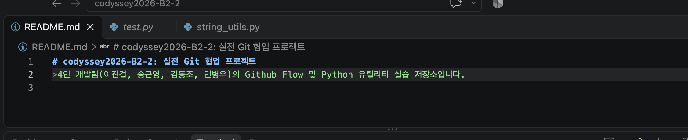

  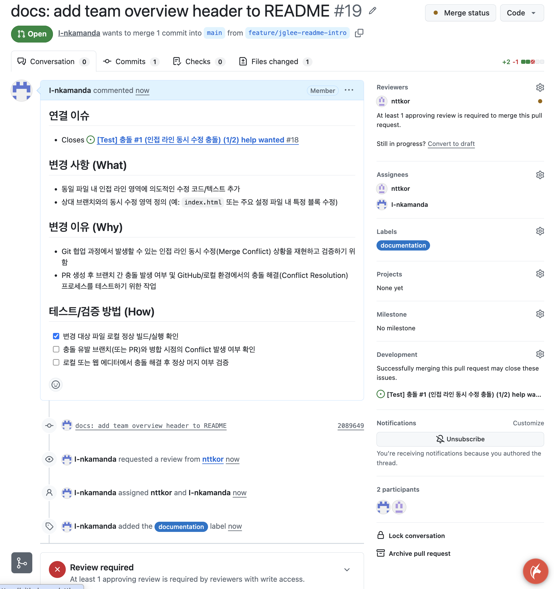

- **김동조(`feature/djkim-readme-intro`)의 동일 구간 수정 및 충돌 발생**:
  - 이진걸의 PR이 병합되기 전 시점인 `ee51120` 커밋을 기반으로 `feature/djkim-readme-intro` 브랜치에서 동일한 `README.md`의 1~2번째 줄을 "Python Utility & Git Workflow Lab" 소개 문구로 다르게 수정하고 커밋(`715bdc8`, `docs: update README title with workflow lab description`) 및 원격 푸시를 수행했다.
  - 이후 최신 `origin/main`(`47eb800`)을 로컬 브랜치로 병합(`git merge origin/main`)하자, 같은 파일(`README.md`)의 같은 라인 구간(1~2행 Hunk)이 양쪽 브랜치에서 서로 다르게 수정되어 Git이 자동 병합할 수 없는 `CONFLICT (content): Merge conflict in README.md`가 발생했다.

### 충돌 내용(Conflict markers)
`git merge origin/main` 실행 직후 `README.md`에 삽입된 충돌 마커 원문:

```txt
<<<<<<< HEAD
    # Python Utility & Git Workflow Lab (Team B2-2)
    > 실무 중심의 PR 코드 리뷰, 충돌 해결, 트러블슈팅을 체득하는 협업 레포지토리입니다.
=======
# codyssey2026-B2-2: 실전 Git 협업 프로젝트
>4인 개발팀(이진걸, 송근영, 김동조, 민병우)의 Github Flow 및 Python 유틸리티 실습 저장소입니다.
>>>>>>> origin/main
```

- `<<<<<<< HEAD` ~ `=======`: 현재 체크아웃된 내 브랜치(`feature/djkim-readme-intro`, 커밋 `715bdc8`)에서 수정한 내용(Current Change)
- `=======` ~ `>>>>>>> origin/main`: 원격 `main` 브랜치(`47eb800`, 이진걸의 PR #19 병합본)에서 들어온 내용(Incoming Change)

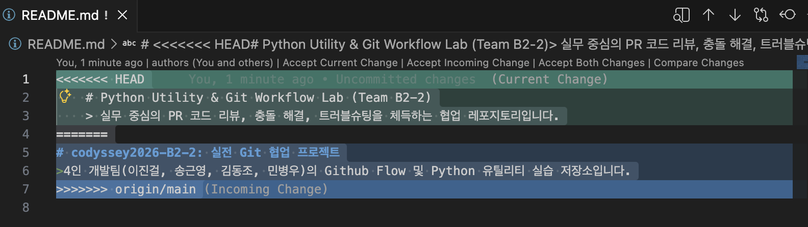

### 해결 과정(How)
- **선택한 해결 전략**: **Keep Both + 통합 리팩토링 (Combine & Refactor)**
  - **선택 이유**: 이진걸이 작성한 문구에는 **프로젝트 공식 명칭과 4인 팀원 명단(이진걸, 송근영, 김동조, 민병우)** 이 명확히 담겨 있고, 김동조가 작성한 문구에는 **실습의 핵심 목적(PR 코드 리뷰, 충돌 해결, 트러블슈팅)** 이 구체적으로 표현되어 있었다. 어느 한쪽만 선택(`Accept Current` 또는 `Accept Incoming`)하면 유용한 정보가 유실되므로, 두 설명의 장점을 결합하여 하나의 완성된 헤더로 통합 리팩토링하는 전략을 택했다.
- **실제로 수행한 명령 및 절차**:
  ```bash
  # 1) 이진걸 님의 선행 PR 병합 전 시점(ee51120)에서 feature/djkim-readme-intro 브랜치 준비 및 수정 커밋
  git checkout -b feature/djkim-readme-intro
  git reset --hard ee51120
  # (README.md 1~2행 수정 후)
  git add README.md
  git commit -m "docs: update README title with workflow lab description"
  git push origin feature/djkim-readme-intro

  # 2) 원격 최신 main(47eb800) 가져오기 및 병합 시도 → 충돌 발생 확인
  git fetch origin
  git merge origin/main

  # 3) 에디터에서 충돌 마커(<<<<<<<, =======, >>>>>>>)를 제거하고 두 문구를 통합하여 저장
  # 4) 해결된 파일을 스테이징하고 병합 커밋 생성 및 원격 푸시
  git add README.md
  git commit -m "docs: resolve merge conflict in README intro by combining both descriptions"
  git push origin feature/djkim-readme-intro
  ```

- **실제 터미널 출력(발췌)**:
  ```text
  mpeg46551@c4r10s1 codyssey2026-B2-2 % git checkout -b feature/djkim-readme-intro
  Switched to a new branch 'feature/djkim-readme-intro'
  mpeg46551@c4r10s1 codyssey2026-B2-2 % git reset --hard ee51120
  HEAD is now at ee51120 Merge pull request #11 from codi-modi/feature/djkim-list-utils
  mpeg46551@c4r10s1 codyssey2026-B2-2 % git add README.md
  mpeg46551@c4r10s1 codyssey2026-B2-2 % git commit -m "docs: update README title with workflow lab description"
  [feature/djkim-readme-intro 715bdc8] docs: update README title with workflow lab description
   1 file changed, 2 insertions(+), 1 deletion(-)
  mpeg46551@c4r10s1 codyssey2026-B2-2 % git push origin feature/djkim-readme-intro
  To https://github.com/codi-modi/codyssey2026-B2-2
   * [new branch]      feature/djkim-readme-intro -> feature/djkim-readme-intro

  mpeg46551@c4r10s1 codyssey2026-B2-2 % git fetch origin
  mpeg46551@c4r10s1 codyssey2026-B2-2 % git merge origin/main
  Auto-merging README.md
  CONFLICT (content): Merge conflict in README.md
  Automatic merge failed; fix conflicts and then commit the result.

  mpeg46551@c4r10s1 codyssey2026-B2-2 % git add README.md
  mpeg46551@c4r10s1 codyssey2026-B2-2 % git commit -m "docs: resolve merge conflict in README intro by combining both descriptions"
  [feature/djkim-readme-intro 1aef0a8] docs: resolve merge conflict in README intro by combining both descriptions
  mpeg46551@c4r10s1 codyssey2026-B2-2 % git push origin feature/djkim-readme-intro
  To https://github.com/codi-modi/codyssey2026-B2-2
     715bdc8..1aef0a8  feature/djkim-readme-intro -> feature/djkim-readme-intro
  ```

- **최종 통합된 `README.md` 내용**:
  ```markdown
  # Codyssey 2026 B2-2: 실전 Git 협업 프로젝트 (Python Utility & Git Workflow Lab)
  > 4인 개발팀(이진걸, 송근영, 김동조, 민병우)이 실무 중심의 GitHub Flow, PR 코드 리뷰, 충돌 해결, 트러블슈팅을 체득하는 협업 저장소입니다.
  ```

### 결과(Outcome)
- 충돌 해결 병합 커밋(`1aef0a8`)을 푸시한 직후 [PR #21](https://github.com/codi-modi/codyssey2026-B2-2/pull/21)의 충돌 경고가 해제되었고, 이진걸(`I-nkamanda`)의 리뷰 및 승인을 거쳐 `main` 브랜치에 최종 병합(`668f42b`)되었다.
- **관련 링크 및 커밋 해시**:
  - 선행 PR (이진걸): [PR #19 (`feature/jglee-readme-intro`)](https://github.com/codi-modi/codyssey2026-B2-2/pull/19) — 커밋 [`2089649`](https://github.com/codi-modi/codyssey2026-B2-2/commit/2089649b2c9f836b05de1c8b97fe33fd5dca05d5), 병합 커밋 [`47eb800`](https://github.com/codi-modi/codyssey2026-B2-2/commit/47eb800)
  - 후행 PR 및 충돌 해결 (김동조): [PR #21 (`feature/djkim-readme-intro`)](https://github.com/codi-modi/codyssey2026-B2-2/pull/21) — 작업 커밋 [`715bdc8`](https://github.com/codi-modi/codyssey2026-B2-2/commit/715bdc8f41a05f3665ee6256243c153d9c2edeb0), 충돌 해결 커밋 [`1aef0a8`](https://github.com/codi-modi/codyssey2026-B2-2/commit/1aef0a814fee009d4e7fdad698ae87a2a773ab2c), 최종 병합 커밋 [`668f42b`](https://github.com/codi-modi/codyssey2026-B2-2/commit/668f42b8375349216bf61e654ac3d26ba4239243)

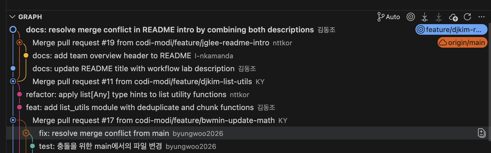

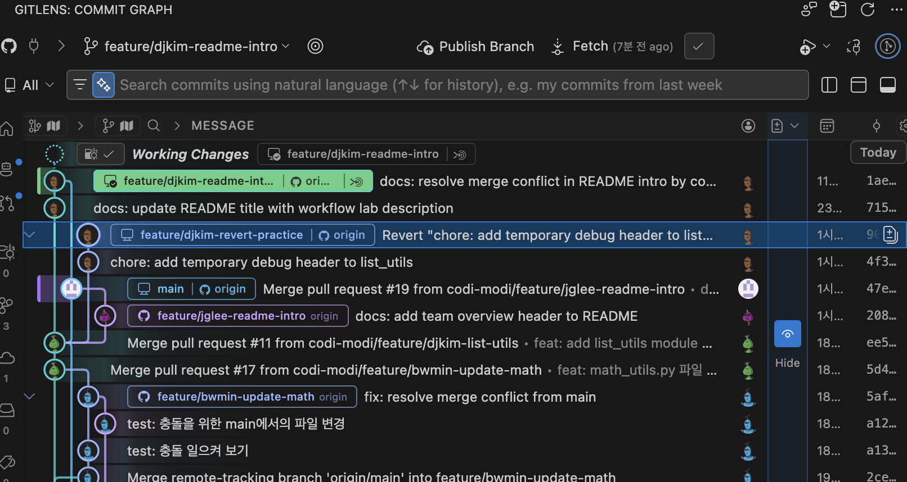

### 배운 점(Learnings)
- `README.md`나 설정 파일처럼 여러 팀원이 동시에 수정하기 쉬운 공용 문서는 작업 전에 반드시 `git fetch origin && git pull origin main`으로 최신 `main` 상태를 먼저 동기화한 뒤 브랜치를 생성해야 불필요한 충돌을 예방할 수 있다.
- 에디터의 `Accept Incoming Change`나 `Accept Current Change` 버튼을 무작정 누르면 한쪽의 작업물이 통째로 날아갈 수 있으므로, 먼저 상대방(작성자)과 수정 의도를 공유한 뒤 두 변경사항을 문맥에 맞게 조합(수동 편집)하는 과정이 중요하다.

---

## 충돌 기록 #2: 비자명 충돌 — 파일 이름 변경(`git mv`) vs 파일 내용 수정 및 동일 Hunk 수정 (`src/math_utils.py` ↔ `src/calculator_utils.py`)

### 참여자
- **작성자 (후행 기능 추가 및 충돌 해결)**: 민병우 (`byungwoo2026`) — 브랜치 `feature/bwmin-update-math`
- **상대 (선행 파일명 변경 및 `main` 병합)**: 송근영 (`KY` / `x0cloud69`) — 브랜치 `feature/kysong-rename-math`

### 상황(What happened)
과제 명세서 4-7절의 비자명 충돌 시나리오(**"한쪽은 파일 이동/이름 변경, 다른 한쪽은 내용 수정"** 및 **"동일 파일 인접 Hunk 수정"**)를 검증하기 위해 2단계로 실습을 진행했다.

1. **1단계: 파일 이름 변경(`math_utils.py` → `calculator_utils.py`) vs 파일 하단 함수 추가(`calculate_median`) — Git `ort` 전략의 자동 Rename 추적 확인**
   - 동일한 `main` 커밋(`26d6f69`)에서 송근영(`feature/kysong-rename-math`)과 민병우(`feature/bwmin-update-math`)가 동시에 브랜치를 분기했다 (`screenshots/conflict_2-1.png`, `conflict_2-3.png`).
   - **송근영(`feature/kysong-rename-math`)**: `src/math_utils.py`를 `src/calculator_utils.py`로 파일명을 변경(`rename src/{math_utils.py => calculator_utils.py} (92%)`)하고 1행 모듈 독스트링을 `"계산기 및 기초 통계 유틸리티 모듈 (담당: 송근영)."`으로 수정하여 커밋(`0adda57`)했다. 이어서 `docs/.github/CODEOWNERS`의 파일 경로도 `/src/calculator_utils.py`로 수정(`ce16370`)한 뒤 [PR #15](https://github.com/codi-modi/codyssey2026-B2-2/pull/15)(연결 이슈 `#14`)를 생성했고, 이진걸·민병우의 리뷰 및 승인을 거쳐 `main`에 먼저 병합(`6a5499e`)했다.

     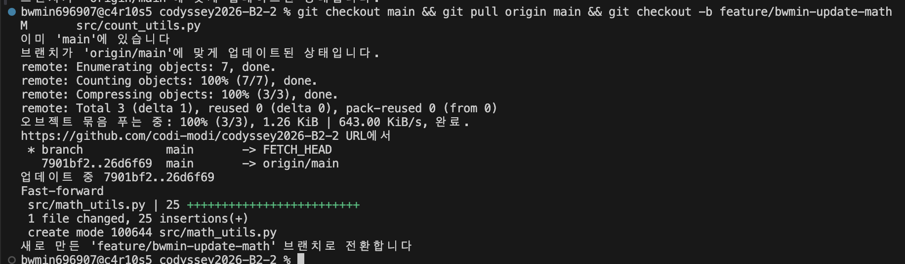

     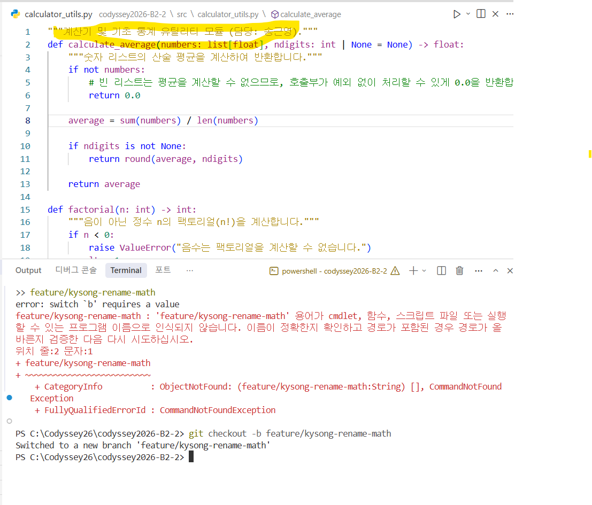

     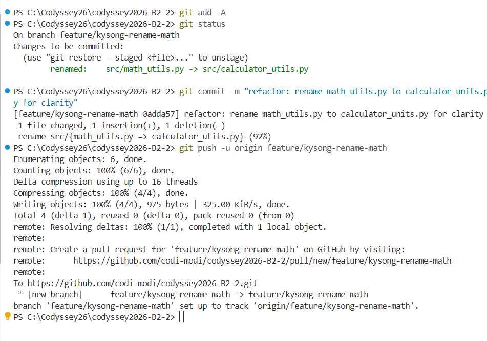

     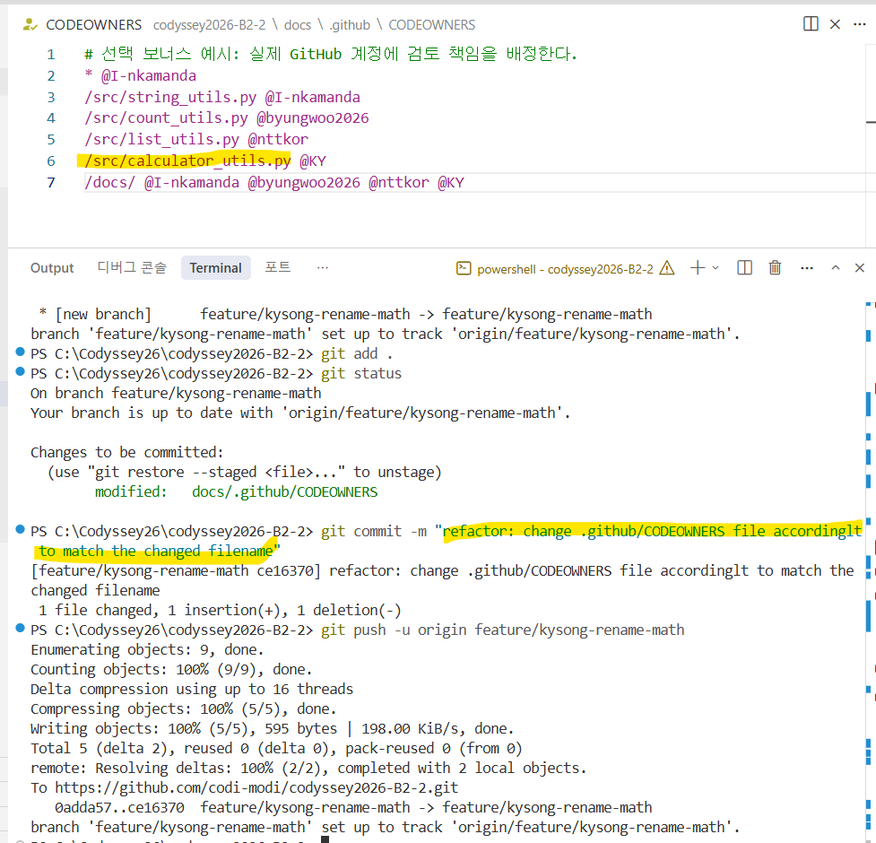

     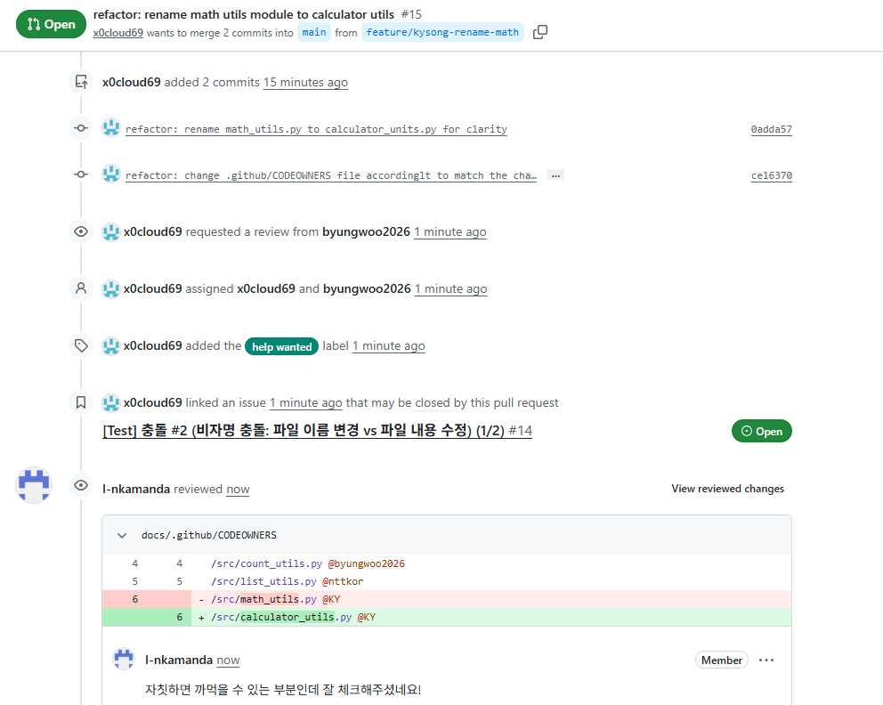

     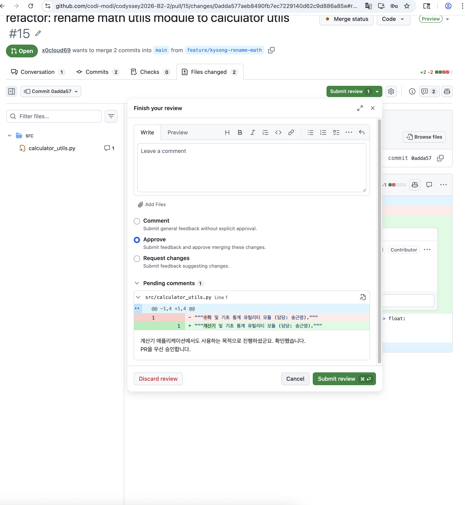

   - **민병우(`feature/bwmin-update-math`)**: 아직 파일명이 `src/math_utils.py`인 구버전 브랜치에서 파일 하단(23~39행)에 중앙값 계산 함수 `calculate_median`을 추가하고 커밋(`8c554a7`, `feat: add calculate_median function to math_utils`) 및 푸시했다.

     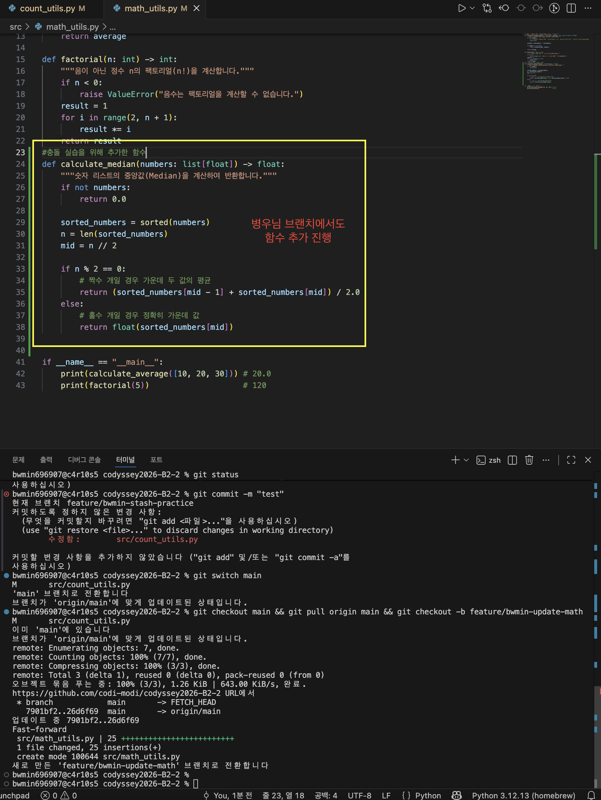

     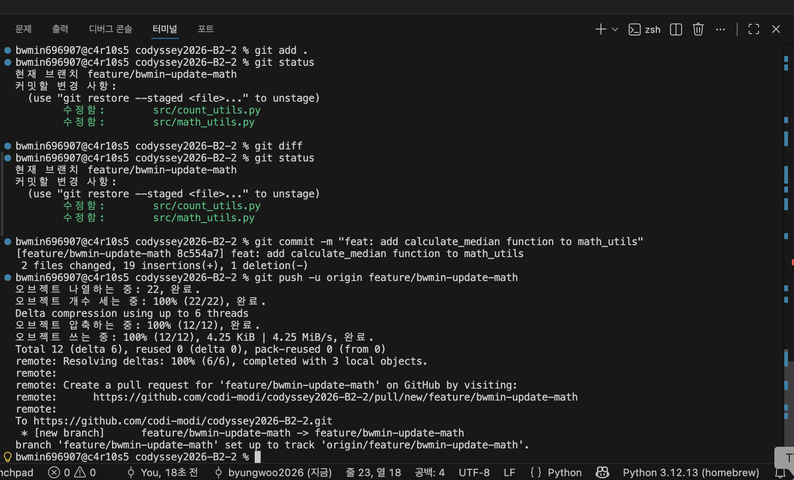

   - **1차 병합 결과 (Git `ort` 전략의 자동 병합 발견)**: 민병우가 `git fetch origin && git merge origin/main`을 실행하자, Git의 기본 병합 엔진인 **`ort`(Ostensibly Recursive's Twin) 전략**이 두 파일의 내용 유사도(95%)를 기반으로 이름 변경(`src/{math_utils.py => calculator_utils.py}`)을 자동 감지(Rename Detection)했다. 송근영이 수정한 라인(1행 모듈 독스트링)과 민병우가 추가한 라인(23~39행 `calculate_median` 함수)이 서로 겹치지 않았기 때문에, Git이 충돌을 발생시키지 않고 `src/calculator_utils.py`로 두 변경사항을 자동 병합(`2ce9f86`)해 주었다.

2. **2단계: 파일명 재변경 및 동일 Hunk(함수 독스트링 3행) 동시 수정을 통한 수동 충돌(`CONFLICT (content)`) 재현**
   - `ort` 자동 병합을 넘어 개발자가 직접 개입해야 하는 충돌을 명확히 재현하기 위해, 파일명을 `src/math_utils.py`로 되돌리면서 `calculate_average` 함수의 독스트링(3행)을 `feature/bwmin-update-math`(`a13faf7`)와 `main`(`a12aeb7`) 양쪽에서 서로 다르게 수정한 뒤 `git merge main`을 실행했다.
   - 그 결과 `자동 병합: src/math_utils.py` / `충돌 (내용): src/math_utils.py에 병합 충돌`이 발생하며 수동 해결 단계로 진입했다.

   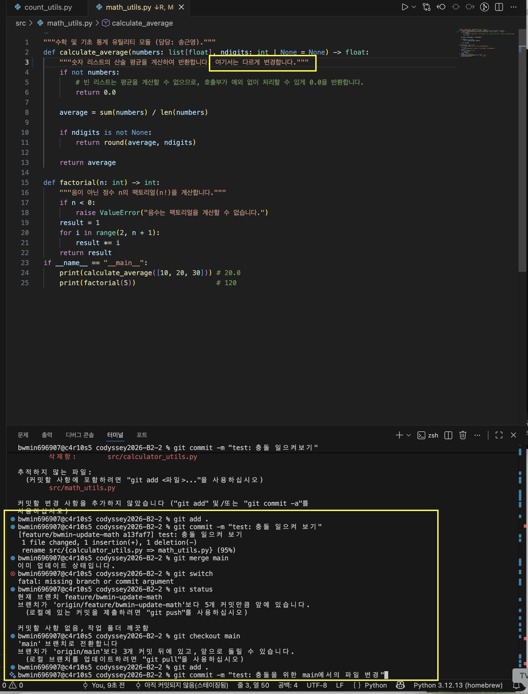

### 충돌 내용(Conflict markers)
`feature/bwmin-update-math` 브랜치에서 `git merge main` 실행 시 `src/math_utils.py` 2~8행에 나타난 충돌 마커 원문:

```txt
def calculate_average(numbers: list[float], ndigits: int | None = None) -> float:
<<<<<<< HEAD
    """숫자 리스트의 산술 평균을 계산하여 반환합니다. 또한 이 줄을 다르게 수정하려고 합니다."""
=======
    """숫자 리스트의 산술 평균을 계산하여 반환합니다. 여기서는 다르게 변경합니다."""
>>>>>>> main
    if not numbers:
```

- `<<<<<<< HEAD` ~ `=======`: `feature/bwmin-update-math` 브랜치(`a13faf7`)에서 수정한 독스트링(현재 변경 사항)
- `=======` ~ `>>>>>>> main`: `main` 브랜치(`a12aeb7`)에서 수정한 독스트링(수신 변경 사항)

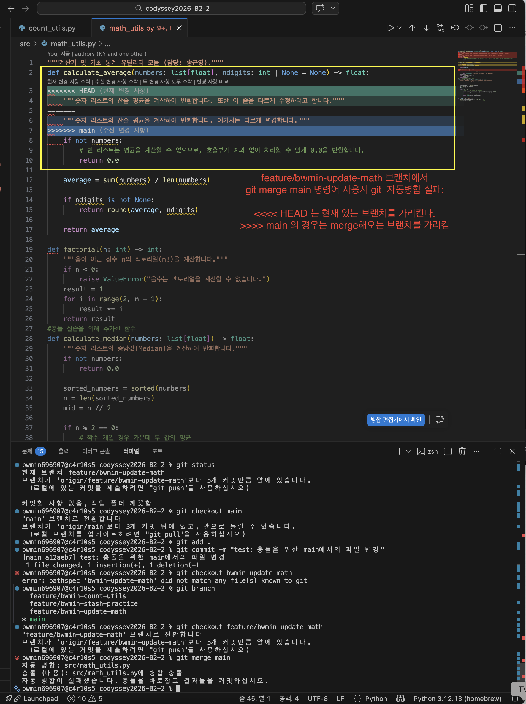

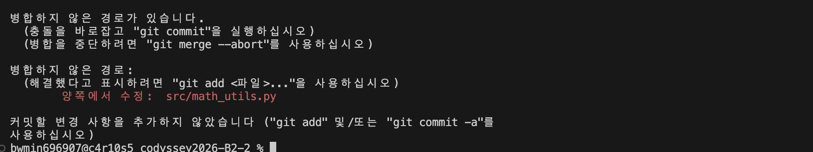

### 해결 과정(How)
- **선택한 해결 전략**: **수신 변경사항 채택(Choose One / `main` 기준 독스트링 수용) + 신규 기능(`calculate_median`) 보존**
  - **선택 이유**: 모듈 상단 설명은 송근영이 리팩토링한 `"계산기 및 기초 통계 유틸리티 모듈 (담당: 송근영)."`을 유지하고, 충돌이 발생한 3행 독스트링은 `main` 브랜치의 변경 방향을 따르되, `feature/bwmin-update-math` 브랜치의 본래 목적인 `calculate_median` 함수 구현 코드(25~41행)는 온전히 보존하도록 통합했다.
- **실제로 수행한 명령 및 절차**:
  ```bash
  # [1단계] 송근영 PR #15(파일명 변경) 병합 후 민병우 브랜치에서 1차 병합 (ort 자동 병합 확인)
  git fetch origin
  git merge origin/main

  # [2단계] 동일 Hunk 충돌 재현 및 git merge main 실행
  git checkout feature/bwmin-update-math
  git merge main
  # -> 자동 병합: src/math_utils.py
  # -> 충돌 (내용): src/math_utils.py에 병합 충돌

  # [3단계] 미병합 상태 확인 및 에디터에서 충돌 마커 수동 제거 후 커밋·푸시
  git status
  git add src/math_utils.py
  git commit -m "fix: resolve merge conflict from main"
  git push origin feature/bwmin-update-math
  ```

- **실제 터미널 출력(발췌)**:
  ```text
  bwmin696907@c4r10s5 codyssey2026-B2-2 % git fetch origin
  From https://github.com/codi-modi/codyssey2026-B2-2
   * [새로운 브랜치]   feature/kysong-rename-math -> origin/feature/kysong-rename-math
     26d6f69..6a5499e  main                       -> origin/main

  bwmin696907@c4r10s5 codyssey2026-B2-2 % git merge origin/main
  자동 병합: src/calculator_utils.py
  Merge made by the 'ort' strategy.
   docs/.github/CODEOWNERS                    | 2 +-
   src/{math_utils.py => calculator_utils.py} | 2 +-
   2 files changed, 2 insertions(+), 2 deletions(-)
   rename src/{math_utils.py => calculator_utils.py} (95%)

  bwmin696907@c4r10s5 codyssey2026-B2-2 % git checkout feature/bwmin-update-math
  'feature/bwmin-update-math' 브랜치로 전환합니다
  bwmin696907@c4r10s5 codyssey2026-B2-2 % git merge main
  자동 병합: src/math_utils.py
  충돌 (내용): src/math_utils.py에 병합 충돌
  자동 병합이 실패했습니다. 충돌을 바로잡고 결과물을 커밋하십시오.

  bwmin696907@c4r10s5 codyssey2026-B2-2 % git status
  병합하지 않은 경로가 있습니다.
    (충돌을 바로잡고 "git commit"을 실행하십시오)
    (병합을 중단하려면 "git merge --abort"를 사용하십시오)

  병합하지 않은 경로:
    (해결했다고 표시하려면 "git add <파일>..."을 사용하십시오)
          양쪽에서 수정:  src/math_utils.py

  bwmin696907@c4r10s5 codyssey2026-B2-2 % git add src/math_utils.py
  bwmin696907@c4r10s5 codyssey2026-B2-2 % git commit -m "fix: resolve merge conflict from main"
  [feature/bwmin-update-math 5afa470] fix: resolve merge conflict from main
  bwmin696907@c4r10s5 codyssey2026-B2-2 % git push origin feature/bwmin-update-math
  To https://github.com/codi-modi/codyssey2026-B2-2.git
     8c554a7..5afa470  feature/bwmin-update-math -> feature/bwmin-update-math
  ```

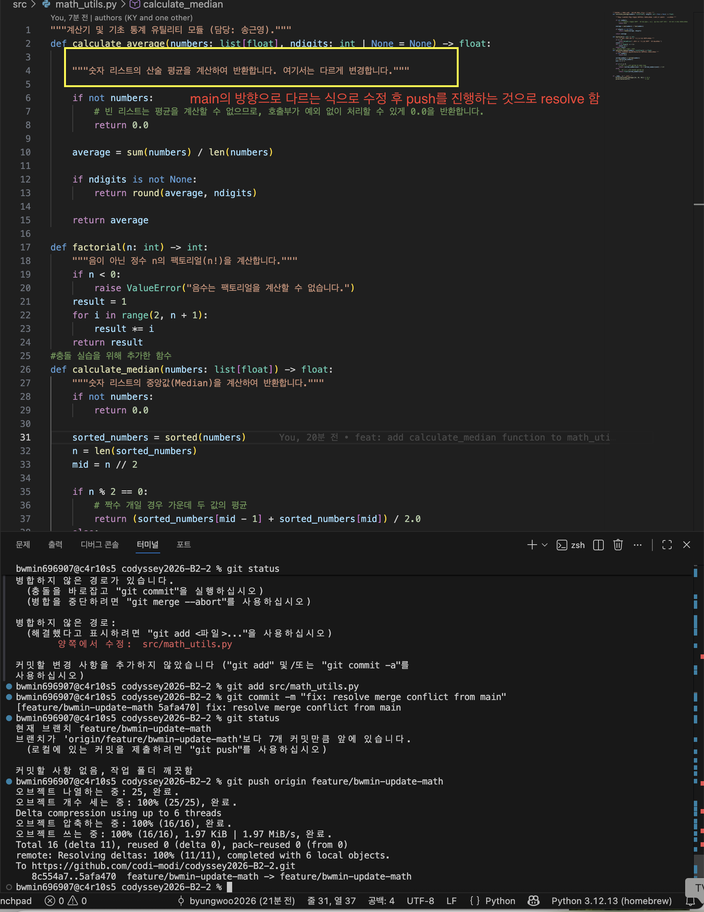

### 결과(Outcome)
- 충돌 해결 커밋(`5afa470`)을 원격 브랜치(`feature/bwmin-update-math`)에 푸시한 뒤, [PR #17](https://github.com/codi-modi/codyssey2026-B2-2/pull/17)(연결 이슈 `#16`)에서 이진걸(`I-nkamanda`)의 코멘트 리뷰와 송근영(`x0cloud69`)의 Approve를 거쳐 `main`에 최종 병합(`5d4a104`)되었다.
- **관련 링크 및 커밋 해시**:
  - 선행 PR (송근영): [PR #15 (`feature/kysong-rename-math`)](https://github.com/codi-modi/codyssey2026-B2-2/pull/15) — 파일명 변경 커밋 [`0adda57`](https://github.com/codi-modi/codyssey2026-B2-2/commit/0adda577aeb8490fb7ec7229140d62c9d886a85e), `CODEOWNERS` 수정 커밋 [`ce16370`](https://github.com/codi-modi/codyssey2026-B2-2/commit/ce16370e68a61ff32e0a2bc5bfb3de8de705e8b1), 병합 커밋 [`6a5499e`](https://github.com/codi-modi/codyssey2026-B2-2/commit/6a5499eb4cca33f7d62cbdbaf9ea05f7e8c0e52d)
  - 후행 PR 및 충돌 해결 (민병우): [PR #17 (`feature/bwmin-update-math`)](https://github.com/codi-modi/codyssey2026-B2-2/pull/17) — `calculate_median` 추가 커밋 [`8c554a7`](https://github.com/codi-modi/codyssey2026-B2-2/commit/8c554a7b0ea91d26422d971d05e6ab23bcdef272), `ort` 자동 병합 확인 커밋 [`2ce9f86`](https://github.com/codi-modi/codyssey2026-B2-2/commit/2ce9f86dbc0af44b4e50eb5db708ddc2406518e1), 충돌 재현 커밋 [`a13faf7`](https://github.com/codi-modi/codyssey2026-B2-2/commit/a13faf75833537ca5fcdb3269f1d67cf315edd4e)·[`a12aeb7`](https://github.com/codi-modi/codyssey2026-B2-2/commit/a12aeb753e010a2a55741dd4d7a3009da8322c10), 충돌 해결 커밋 [`5afa470`](https://github.com/codi-modi/codyssey2026-B2-2/commit/5afa4704feeb2e747d7f51cc077d411f0b0e4735), 최종 병합 커밋 [`5d4a104`](https://github.com/codi-modi/codyssey2026-B2-2/commit/5d4a10419636ee4d1f85e3ee4baf1837c1555a4c)

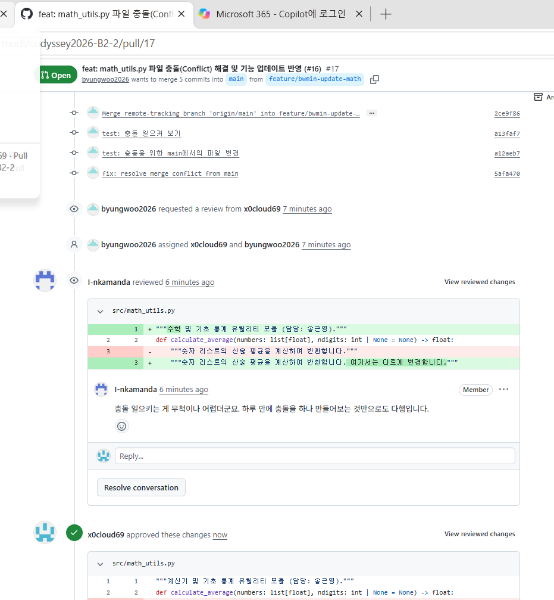

### 배운 점(Learnings)
- **Git `ort` 병합 전략의 Rename Detection 이해**: 한쪽 브랜치에서 파일 이름을 변경(`git mv`)하고 다른 브랜치에서 기존 파일에 함수를 추가하더라도, 파일 내용 유사도(기본 임계값 50% 이상, 본 실습에서는 95%)가 높고 수정한 라인 위치가 겹치지 않으면 Git의 `ort` 병합 엔진이 이름 변경을 자동 추적하여 충돌 없이 병합해 준다는 사실을 실습으로 직접 확인했다.
- **비자명 충돌이 실제로 발생하는 조건**: 파일 이름 변경과 더불어 **동일한 라인 구간(Hunk)** 이 양쪽에서 서로 다르게 수정되거나, 파일 유사도가 크게 떨어질 정도로 대규모 리팩토링이 일어나면 자동 병합이 실패하므로 수동 해결이 필요하다.
- **리팩토링 작업 시 팀 커뮤니케이션 수칙**: 파일명 변경(`git mv`), 폴더 구조 이동, `.github/CODEOWNERS` 수정처럼 다른 팀원의 작업 경로에 영향을 주는 리팩토링은 기능 개발과 동시에 진행하지 말고, 팀원들에게 사전 공유한 뒤 짧은 단위의 PR로 먼저 병합하고 전원이 `git pull origin main`을 수행한 후 다음 작업을 이어가는 것이 가장 안전하다.
