# Troubleshooting Log

팀원 4명이 Git 트러블슈팅 필수 4대 시나리오(`amend`, `reset --soft`, `revert`, `stash`)를 **1명당 1종씩** 직접 터미널에서 재현하고, 실제 출력과 스크린샷을 근거로 정리한 기록입니다.

| # | 시나리오 | 참여자 (역할) | 실습 브랜치 | 증빙 |
|---|----------|---------------|-------------|------|
| 1 | `git commit --amend` — 직전 커밋 메시지 수정 | 이진걸 (실습 수행) | `feature/jglee-amend-practice` | `screenshots/scenario_a_1.png`, `scenario_a_2.png` |
| 2 | `git reset --soft HEAD~1` — 로컬 커밋 취소 + 변경 유지 | 송근영 (실습 수행) | `feature/kysong-reset-practice` | `screenshots/scenario_b.png`, [원본 로그](raw_logs/troubleshooting_raw.md) (reflog 기록) |
| 3 | `git revert` — push된 커밋 안전하게 취소 | 김동조 (실습 수행) | `feature/djkim-revert-practice` | `screenshots/scenario_c_1.png`, `scenario_c_2.png` |
| 4 | `git stash` / `git stash pop` — 작업 임시 보관 후 브랜치 전환 | 민병우 (실습 수행) | `feature/bwmin-stash-practice` | `screenshots/scenario_d_1.png`, `scenario_d_2.png` |

> 문서 정리: 민병우 / 리뷰어: 송근영

---

## 시나리오 1: git commit --amend (amend)

### 참여자
- 이진걸 (실습 수행: 커밋 생성 → 메시지 교정 → 로그 확인)

### 상황
- 로컬 기능 브랜치에서 커밋 메시지에 오타(`updte`)를 낸 채 커밋했다.
- 아직 원격(`origin`)에 push하기 전이므로, 직전 커밋 메시지만 컨벤션에 맞게 고치고 싶은 상황이다.

### 시도한 명령/절차
```bash
git status                                   # main, working tree clean 확인
git checkout -b feature/jglee-amend-practice
echo "" >> README.md                         # README.md 하단에 임시 줄 추가
git add README.md
git commit -m "docs: updte readme title(typo)"   # 오타 커밋 생성
git log -1 --oneline                         # 수정 전 커밋 해시 기록
git commit --amend -m "docs: clarify project title and overview in README.md"
git log -5 --oneline                         # 수정 후 로그 확인
```

실제 출력(발췌):
```text
$ git commit -m "docs: updte readme title(typo)"
[feature/jglee-amend-practice 7bb7583] docs: updte readme title(typo)
 1 file changed, 1 insertion(+)

$ git log -1 --oneline
7bb7583 (HEAD -> feature/jglee-amend-practice) docs: updte readme title(typo)

$ git commit --amend -m "docs: clarify project title and overview in README.md"
[feature/jglee-amend-practice 26328d5] docs: clarify project title and overview in README.md
 Date: Thu Oct 22 14:00:55 2026 +0900
 1 file changed, 1 insertion(+)

$ git log -5 --oneline
26328d5 (HEAD -> feature/jglee-amend-practice) docs: clarify project title and overview in README.md
7901bf2 (origin/main, origin/HEAD, main) Merge pull request #9 from codi-modi/feature/bwmin-count-utils
00ac08b (origin/feature/bwmin-count-utils) fix: strip punctuation before counting words in count_utils
7f07ac4 Merge pull request #8 from codi-modi/feature/jglee-string-utils
7c9bc42 (origin/feature/jglee-string-utils, feature/jglee-string-utils) refactor(string_utils): ...
```

증빙 스크린샷:

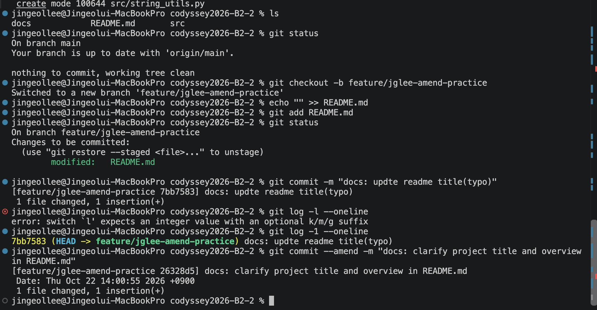

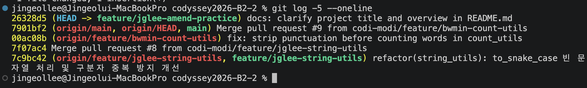

### 결과
- 커밋 해시가 `7bb7583` → `26328d5`로 **바뀌었다.** 메시지만 고쳤지만 Git은 새 커밋 객체를 만들어 기존 커밋을 대체한다.
- `git log -5 --oneline`에서 오타 커밋(`7bb7583`)은 더 이상 브랜치에 보이지 않고, 교정된 커밋이 `origin/main`(`7901bf2`) 바로 위에 1개만 남았다. `origin/feature/jglee-amend-practice`가 로그에 없으므로 이 커밋은 원격에 올라가지 않은 로컬 커밋임을 확인할 수 있다.
- `Date:` 줄은 최초 커밋 시각(Oct 22 14:00:55)을 그대로 유지한다.
- 실습 중 오타: `git log -l --oneline`을 입력해 `error: switch 'l' expects an integer value with an optional k/m/g suffix`가 발생했다. 숫자 `1`이 아니라 영문 `l`을 입력한 실수이며, `git log -1 --oneline`으로 다시 실행해 해결했다.
- **주의할 점**: `amend`는 SHA를 새로 만들기 때문에 **이미 push한 커밋에 쓰면** 원격 히스토리와 갈라져 `--force` push가 필요해지고, 해당 브랜치를 pull한 팀원의 히스토리가 깨진다. 반드시 **push 전 로컬 커밋**에만 사용한다.

### 왜 이 방법을 선택했는가(Why)
- 직전 커밋 하나의 메시지만 고치는 것이 목적이라, 새 커밋을 덧붙이면(`fix: typo` 등) 의미 없는 커밋이 남아 커밋 컨벤션과 히스토리 가독성이 나빠진다.
- 아직 push 전이라 다른 사람에게 영향이 없으므로, 히스토리를 깔끔하게 유지할 수 있는 `--amend`가 가장 적합하다.

---

## 시나리오 2: git reset --soft HEAD~1 (reset)

### 참여자
- 송근영 (실습 수행: 성급한 커밋 생성 → `reset --soft`로 커밋만 취소 → 상태 확인)

### 상황
- 디버깅 코드가 남아 있거나 추가로 수정할 파일이 있는데 성급하게 `git commit`을 실행했다.
- 작업 내역(Staging 상태)은 그대로 살려둔 채 **커밋만 취소**하고 싶은 상황이다.

### 시도한 명령/절차
```bash
git checkout -b feature/kysong-reset-practice
echo "# TODO: add median function" >> src/math_utils.py
git add src/math_utils.py
git commit -m "feat: add incomplete median note"
git reset --soft HEAD~1        # 직전 커밋만 취소, 변경사항은 Staging Area에 유지
git status                     # Changes to be committed에 파일이 남아 있는지 확인
git reflog show feature/kysong-reset-practice --date=iso   # (재현용 예시) 아래 reflog 기록과 같은 형식으로 이동 이력 확인
```

실제 출력(발췌):
```text
$ git commit -m "feat: add incomplete median note"
[feature/kysong-reset-practice 64409e0] feat: add incomplete median note
 1 file changed, 2 insertions(+), 1 deletion(-)

$ git reset --soft HEAD~1

$ git status
On branch feature/kysong-reset-practice
Changes to be committed:
  (use "git restore --staged <file>..." to unstage)
        modified:   src/math_utils.py
```

reflog 확인 결과(송근영 기록, [취합 원본 로그](raw_logs/troubleshooting_raw.md)):
```text
0a1bf3c feature/kysong-reset-practice@{2026-10-22 15:56:27 +0900}: commit: Update math utils average handling
64a24bd feature/kysong-reset-practice@{2026-10-22 14:08:55 +0900}: reset: moving to HEAD~1
64409e0 feature/kysong-reset-practice@{2026-10-22 14:08:42 +0900}: commit: feat: add incomplete median note
64a24bd feature/kysong-reset-practice@{2026-10-22 14:06:27 +0900}: branch: Created from HEAD
```

reset 전/후 비교:

| 항목 | 내용 |
|------|------|
| 리셋 전 커밋 | `64409e0` `feat: add incomplete median note` |
| 리셋 전 커밋의 변경 내용 | `src/math_utils.py \| 3 ++-` (1 file changed, 2 insertions(+), 1 deletion(-)) |
| 리셋 지점 | `reset: moving to HEAD~1` (2026-10-22 14:08:55) |
| 리셋 후 HEAD가 가리키는 커밋 | `64a24bd` `feat: support optional rounding precision in calculate_average` |

증빙 스크린샷:

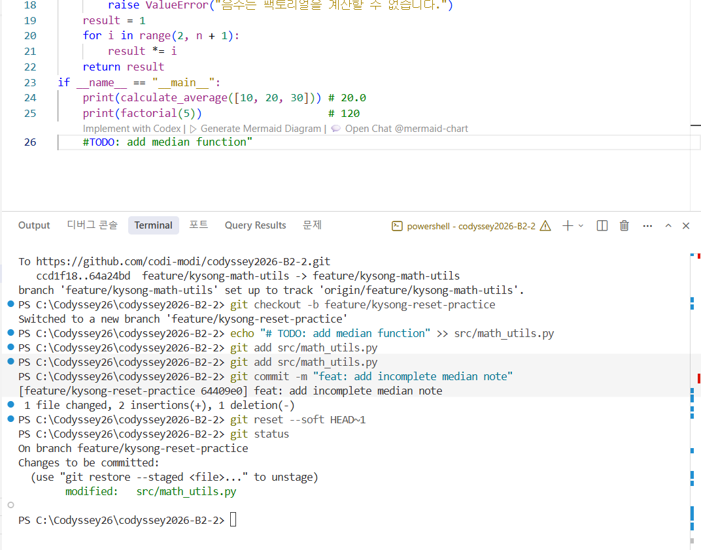

### 결과
- 커밋 `64409e0`이 브랜치에서 취소되었고, `git status`에서 `src/math_utils.py`가 **`Changes to be committed`(Staging, 초록색)** 에 그대로 남아 있음을 확인했다. 파일 내용은 사라지지 않았다.
- 이 상태에서 파일을 더 수정하거나 디버깅 코드를 지운 뒤 다시 `git commit`으로 제대로 된 커밋을 만들 수 있다.
- reflog로 **HEAD가 실제로 어디로 움직였는지** 시간순으로 확인했다.

  | 시각 (2026-10-22) | 이벤트 | 브랜치가 가리킨 커밋 |
  |-------------------|--------|----------------------|
  | 14:06:27 | `branch: Created from HEAD` — 실습 브랜치 생성 | `64a24bd` |
  | 14:08:42 | `commit: feat: add incomplete median note` | `64409e0` |
  | 14:08:55 | `reset: moving to HEAD~1` | `64a24bd` (커밋 직전 상태로 복귀) |
  | 15:56:27 | `commit: Update math utils average handling` — reset 이후 같은 브랜치에서 작업 계속 | `0a1bf3c` |

  - 커밋 후 13초 만에(14:08:42 → 14:08:55) 취소했고, HEAD~1은 브랜치를 만들 때의 커밋 `64a24bd`와 같다. 즉 reset은 "커밋 직전 상태"로 정확히 되돌렸다.
  - `64a24bd`(`feat: support optional rounding precision in calculate_average`)는 민병우 저장소에서도 조회되며, 커밋 메시지가 위 기록과 일치한다.
  - `64409e0`과 `0a1bf3c`는 원격에 push하지 않은 송근영의 로컬 커밋이라 민병우 저장소에서는 조회되지 않는다. 따라서 이 두 커밋은 위 reflog 출력을 근거로 한다.
- reset 이후에도 `64409e0` 커밋 객체는 reflog에 남아 있다. 브랜치에서 빠졌을 뿐 바로 삭제되지 않으므로, 잘못 취소했다면 `git reflog`에서 해시를 찾아 `git cherry-pick 64409e0` 등으로 되살릴 수 있다(reflog 보관 기간 내).
- 참고: 추가한 주석은 `# TODO: add median function` 1줄이지만 diffstat은 `2 insertions(+), 1 deletion(-)`으로, 기존 줄 1개가 함께 변경된 것으로 집계되었다. 이 기록만으로는 원인을 확정할 수 없어 원인 분석은 생략한다.
- **주의할 점**: `reset`도 히스토리를 되돌리는 명령이므로 **push 전 로컬 커밋**에만 사용한다. 이미 원격에 올라간 커밋을 reset하면 `--force` push가 필요해진다(시나리오 3 참고).

### 왜 이 방법을 선택했는가(Why)
- 목표는 "커밋은 취소하되 작업은 보존"이다. `--soft`는 HEAD 포인터만 한 단계 되돌리고 Staging Area와 작업 폴더를 건드리지 않아 가장 안전하다.
- `--hard`를 썼다면 작업 내용까지 모두 삭제되어 복구가 어렵다.
- `--soft`는 파일뿐 아니라 취소한 커밋 객체도 reflog에 남겨 두므로, 실수했을 때 되돌릴 수 있는 여지가 가장 크다.

| 옵션 | HEAD(커밋) | Staging Area | 작업 폴더(Working Dir) | 용도 |
|------|-----------|--------------|------------------------|------|
| `--soft` | 되돌림 | **유지** | 유지 | 커밋만 취소하고 바로 다시 커밋할 때 |
| `--mixed` (기본값) | 되돌림 | 초기화 | 유지 | 커밋과 스테이징을 모두 취소하고 파일 선택부터 다시 할 때 |
| `--hard` | 되돌림 | 초기화 | **삭제** | 작업 내용까지 완전히 버릴 때 (위험) |

---

## 시나리오 3: git revert (revert)

### 참여자
- 김동조 (실습 수행: 커밋 생성 → 원격 push → `revert`로 역커밋 생성 → 재push)

### 상황
- 이미 원격 브랜치에 push되어 팀원들과 공유된 커밋(`chore: add temporary debug header to list_utils`)에서 문제를 발견했다.
- 히스토리를 강제로 지우지 않고, 반대 변경을 담은 **역커밋**을 만들어 안전하게 되돌려야 하는 상황이다.

### 시도한 명령/절차
```bash
git checkout -b feature/djkim-revert-practice
echo "# 잘못 추가 된 임시 설정" >> src/list_utils.py
git add src/list_utils.py
git commit -m "chore: add temporary debug header to list_utils"
git push -u origin feature/djkim-revert-practice     # 원격에 공유된 상태로 만들기

git revert HEAD --no-edit                            # 직전 커밋(HEAD)을 되돌리는 역커밋 생성
git log -2 --oneline                                 # 원본 커밋과 Revert 커밋이 모두 남았는지 확인
git push origin feature/djkim-revert-practice        # 강제 push 없이 일반 push
```

실제 출력(발췌):
```text
$ git commit -m "chore: add temporary debug header to list_utils"
[feature/djkim-revert-practice 4f380a2] chore: add temporary debug header to list_utils
 1 file changed, 1 insertion(+)

$ git push -u origin feature/djkim-revert-practice
To https://github.com/codi-modi/codyssey2026-B2-2
 * [new branch]      feature/djkim-revert-practice -> feature/djkim-revert-practice
branch 'feature/djkim-revert-practice' set up to track 'origin/feature/djkim-revert-practice'.

$ git revert HEAD --no-edit
[feature/djkim-revert-practice 90216de] Revert "chore: add temporary debug header to list_utils"
 Date: Fri Oct 23 10:34:27 2026 +0900
 1 file changed, 1 deletion(-)

$ git log -2 --oneline
90216de (HEAD -> feature/djkim-revert-practice) Revert "chore: add temporary debug header to list_utils"
4f380a2 (origin/feature/djkim-revert-practice) chore: add temporary debug header to list_utils

$ git push origin feature/djkim-revert-practice
To https://github.com/codi-modi/codyssey2026-B2-2
   4f380a2..90216de  feature/djkim-revert-practice -> feature/djkim-revert-practice
```

증빙 스크린샷:

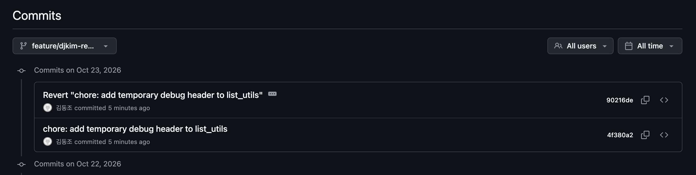

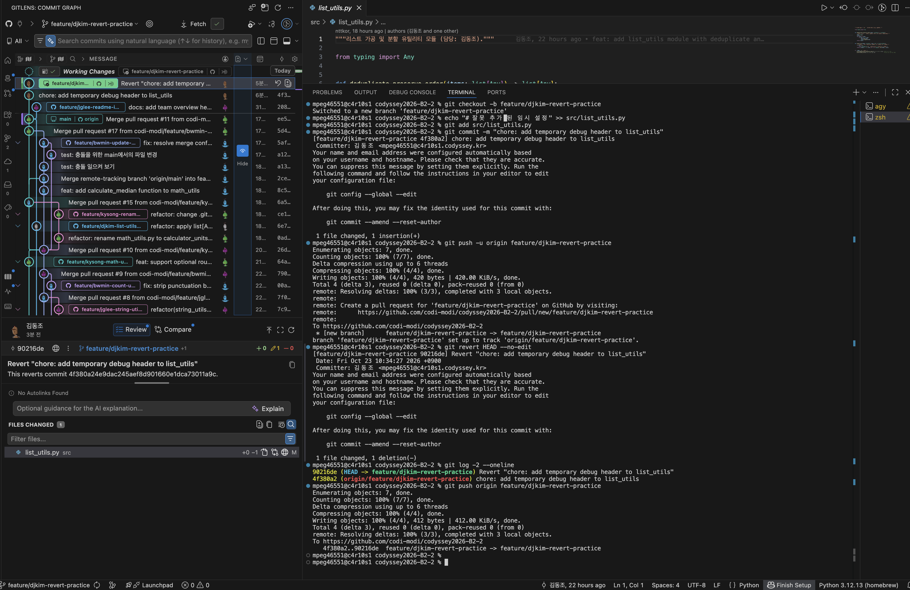

### 결과
- `git revert HEAD --no-edit`으로 기본 메시지 `Revert "chore: add temporary debug header to list_utils"`를 가진 새 커밋 `90216de`가 만들어졌고, 이 커밋은 `1 deletion(-)`으로 원본 커밋이 추가한 1줄을 상쇄했다.
- `git log -2 --oneline`과 GitHub Commits 화면 모두에서 **원본 커밋(`4f380a2`)과 Revert 커밋(`90216de`)이 함께 보인다.** 히스토리는 지워지지 않고 이어서 쌓였다.
- 마지막 push는 `4f380a2..90216de` 형태의 **일반(fast-forward) push**로 성공했으며 `--force`가 필요 없었다.
- 참고(환경 메모): 실습 PC에 `user.name`/`user.email`이 설정되지 않아 커밋 시 `Your name and email address were configured automatically based on your username and hostname.` 경고가 출력되었다. 동작에는 문제가 없었으나, 커밋 작성자 정보가 정확하도록 `git config --global user.name` / `user.email`을 미리 설정해 두는 것이 좋다.
- **주의할 점**: `revert`는 "해당 변경을 상쇄하는 새 커밋"이므로, 되돌린 뒤에도 원본 커밋은 히스토리에 계속 남는다. 병합 커밋을 되돌릴 때는 `-m` 옵션(부모 지정)이 추가로 필요하다.

### 왜 이 방법을 선택했는가(Why)
- 이미 원격에 push된 커밋은 다른 팀원이 pull하여 로컬에 가지고 있을 수 있다.
- 여기에 `reset`으로 히스토리를 지우고 `push --force`를 하면, 팀원의 로컬 히스토리와 원격이 어긋나 `non-fast-forward` 오류와 충돌이 발생하고 팀원의 작업이 꼬이거나 유실될 수 있다.
- `revert`는 기존 히스토리를 보존한 채 되돌리는 변경만 **새 커밋으로 추가**하므로, 팀원이 평소처럼 `git pull`만 하면 된다. 또한 "무엇을, 왜 되돌렸는지"가 기록으로 남아 추적이 가능하다.

---

## 시나리오 4: git stash / git stash pop (stash)

### 참여자
- 민병우 (실습 수행: 미커밋 작업 생성 → stash 보관 → main 확인/pull → 브랜치 복귀 후 pop 복원)

### 상황
- `src/count_utils.py`에 새 기능을 한창 작성 중(미커밋 상태)인데, 긴급하게 `main` 브랜치를 확인하거나 pull 받아야 하는 상황이다.
- 덜 완성된 코드를 `wip` 같은 의미 없는 커밋으로 남기고 싶지 않다(커밋 컨벤션 위반 방지).

### 시도한 명령/절차
```bash
git checkout -b feature/bwmin-stash-practice
echo "# 작업 중인 함수의 초안" >> src/count_utils.py   # 아직 커밋하지 않음
git status

# 1) 미커밋 변경사항을 스태시 스택에 메시지와 함께 임시 보관
git stash push -m "wip: drafting character frequency helper"
git stash list

# 2) 워킹 디렉터리가 깨끗해진 상태에서 main으로 전환하여 확인
git checkout main
git pull origin main

# 3) 작업 브랜치로 복귀하여 보관했던 변경사항 복원 및 스태시 제거
git checkout feature/bwmin-stash-practice
git stash pop
git status
```

실제 출력(발췌, 한글 로케일):
```text
$ git status
현재 브랜치 feature/bwmin-stash-practice
커밋하도록 정하지 않은 변경 사항:
        수정함:        src/count_utils.py

$ git stash push -m "wip: drafting character frequency helper"
Saved working directory and index state On feature/bwmin-stash-practice: wip: drafting character frequency helper

$ git stash list
stash@{0}: On feature/bwmin-stash-practice: wip: drafting character frequency helper

$ git checkout main
'main' 브랜치로 전환합니다
브랜치가 'origin/main'에 맞게 업데이트된 상태입니다.

$ git pull origin main
 * branch            main       -> FETCH_HEAD
이미 업데이트 상태입니다.

$ git stash pop
현재 브랜치 feature/bwmin-stash-practice
커밋하도록 정하지 않은 변경 사항:
        수정함:        src/count_utils.py
Dropped refs/stash@{0} (c168328f6b9b2da90dffbd7b94d2987efab737b6)
```

증빙 스크린샷:

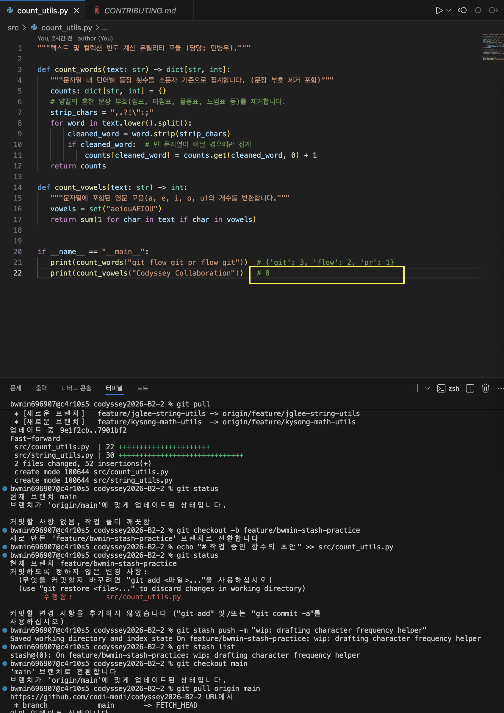

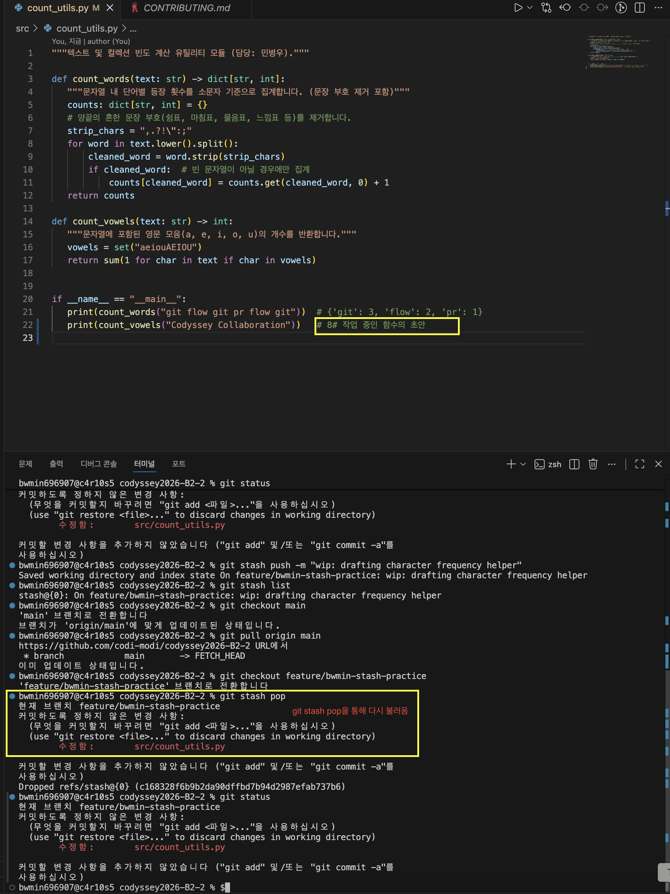

### 결과
- `git stash push` 이후 `git stash list`에 `stash@{0}`이 등록되었고, 작업 폴더가 깨끗해진 상태에서 `main`으로 전환 및 `git pull origin main`을 수행할 수 있었다.
- 작업 브랜치로 돌아와 `git stash pop`을 실행하자 `src/count_utils.py`의 수정 사항이 그대로 복원되었고, 스태시 항목은 `Dropped refs/stash@{0}`로 **목록에서 제거**되었다. 스크린샷(`scenario_d_2.png`)의 편집기에서도 보관했던 `# 작업 중인 함수의 초안` 줄이 복원된 것을 확인할 수 있다.
- 복원된 줄이 22행의 `# 8` 뒤에 `# 8# 작업 중인 함수의 초안` 형태로 붙어 있다. 원본 파일의 마지막 줄에 개행이 없는 상태에서 `echo >>`로 덧붙였기 때문이며, stash/pop과는 무관한 현상이다.
- **주의할 점**
  - 기본 `git stash`는 **추적 중인 파일의 변경사항**만 보관한다. 새로 만든(untracked) 파일까지 보관하려면 `git stash -u`를 사용한다.
  - `stash pop` 시 충돌이 나면 스태시가 목록에서 **자동 삭제되지 않는다.** 충돌을 수동으로 해결한 뒤 `git stash drop`으로 직접 제거해야 한다.
  - 스태시는 로컬 저장소에만 존재하며 push되지 않는다. 여러 개를 쌓아 두면 헷갈리므로 `-m`으로 메시지를 붙여 구분한다.

### 왜 이 방법을 선택했는가(Why)
- 미완성 코드를 `wip` 커밋으로 남기면 의미 없는 커밋이 히스토리에 쌓여 커밋 메시지 컨벤션을 해치고, 나중에 `amend`/`reset`으로 다시 정리해야 하는 부담이 생긴다.
- `git stash`는 커밋 없이 작업 내용을 안전하게 대피시키고, 브랜치 전환/pull이 끝난 뒤 `stash pop`으로 그대로 복구할 수 있어 가장 가볍고 안전하다.

---

## 4종 한눈에 비교

| 상황 | 사용 명령 | 히스토리 변화 | push 후 사용 가능 여부 |
|------|-----------|---------------|------------------------|
| 직전 커밋 메시지(또는 누락 파일)만 고치고 싶다 | `git commit --amend` | 직전 커밋을 새 SHA로 **교체** | 불가 (push 전 로컬 커밋에만) |
| 커밋만 취소하고 변경은 Staging에 유지하고 싶다 | `git reset --soft HEAD~1` | 커밋 **삭제**(변경은 보존) | 불가 (push 전 로컬 커밋에만) |
| 이미 push된 커밋을 안전하게 되돌리고 싶다 | `git revert <commit>` | 상쇄 커밋을 **추가**(기존 보존) | **가능 (권장)** |
| 미커밋 작업을 잠시 치워두고 브랜치를 옮기고 싶다 | `git stash` / `git stash pop` | 히스토리 변화 없음 | 해당 없음 (로컬 임시 보관) |

## 배운 점(Learnings)
- **히스토리를 고쳐 쓰는 명령**(`amend`, `reset`)은 push 전 로컬 커밋에만, **이미 공유된 커밋**은 `revert`로 되돌린다.
- 명령어 입력 실수(`git log -l`)나 공백/개행 문제(`echo >>`)는 실습 결과를 흐리게 하므로, 명령 실행 후 `git status` / `git log`로 항상 결과를 확인한다.
- 커밋을 취소하거나 히스토리를 고쳐 쓴 뒤에는 `git reflog`로 HEAD 이동 이력을 확인해 두면, 무엇을 언제 되돌렸는지 증빙이 되고 실수 시 복구 경로도 된다.
- 공용 실습 PC에서는 커밋 전에 `git config user.name` / `user.email`이 올바르게 설정되어 있는지 먼저 확인한다.


---

## 보너스: git rebase -i로 개인 브랜치 히스토리 정리

### 참여자 및 상황

- 수행자: 이진걸 (`I-nkamanda`)
- 수행일: 2026-10-23 (KST)
- 개인 브랜치: `feature/jglee-rebase-practice`
- 기준 커밋: `1a414fe` (`feature/jglee-submission-doc`에서 분기)
- 대상 파일: [rebase-practice.md](practice/rebase-practice.md)
- 목적: 같은 문서에 대한 연속 커밋 2개를 squash하여 작업 의도가 드러나는 커밋 1개로 정리한다.
- 원본 증빙: [rebase_raw.md](raw_logs/rebase_raw.md). 아래 출력은 원본에서 프롬프트와 브랜치 장식을 생략한 발췌이다.

### 정리 전

문서 제목을 추가한 뒤 설명 한 줄을 추가하여 각각 커밋했다.

```text
67f0552 docs: explain rebase practice purpose
6ebf3dc docs: add interactive rebase practice note
1a414fe chore: configure CODEOWNERS and update submission evidence
```

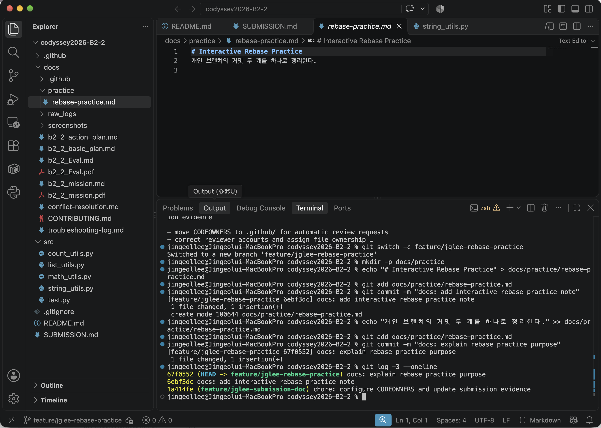

### 실행 절차

1. `git log -3 --oneline`으로 대상 커밋 2개와 기준 커밋을 확인했다.
2. `git rebase -i HEAD~2`를 실행했다. todo 목록은 로그와 달리 오래된 커밋부터 표시된다.
3. 첫 번째 커밋은 `pick`으로 유지하고 두 번째 커밋을 `squash`로 변경했다.

```text
pick 6ebf3dc # docs: add interactive rebase practice note
squash 67f0552 # docs: explain rebase practice purpose
```

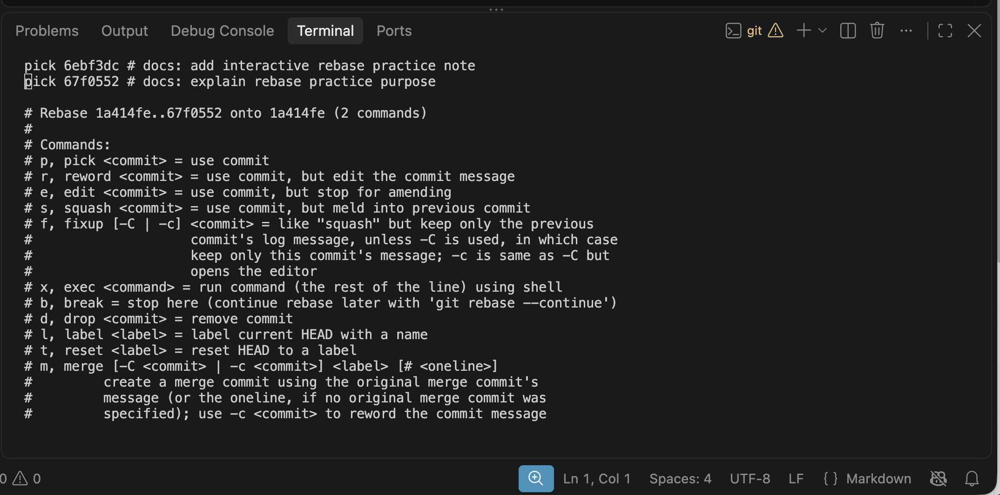

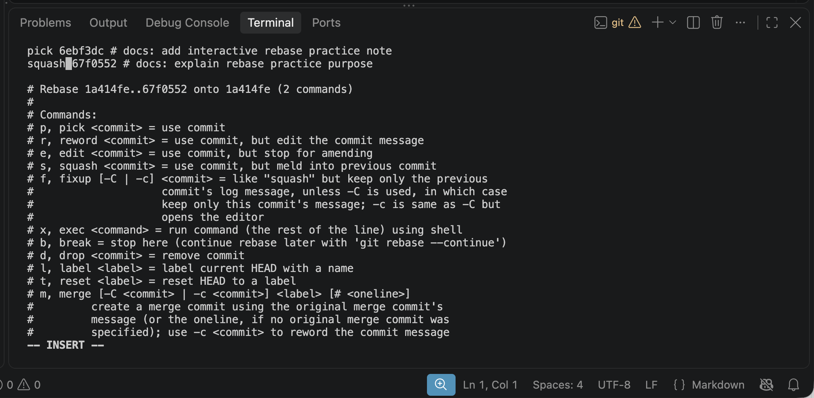

4. Vim에서 `Esc` → `:wq` → Enter로 저장했다. 이어서 열린 메시지 편집기에서 기존 메시지를 정리하고 다음 최종 메시지를 저장했다. 별도 `reword` 명령은 사용하지 않았으며 squash 과정에서 메시지를 수정했다.

```text
docs: document interactive rebase practice
```

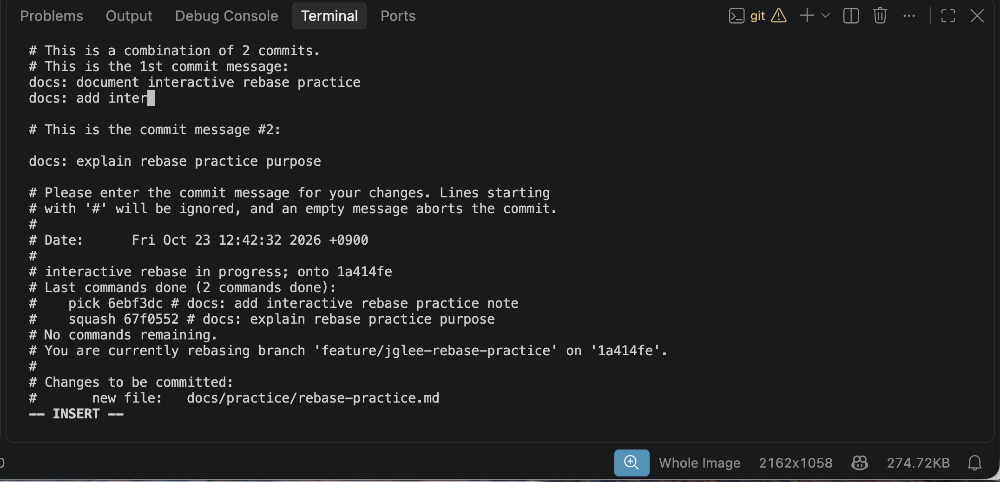

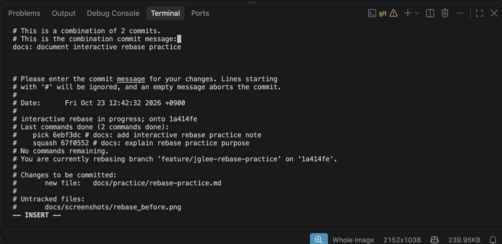

### 정리 후 및 결과

```text
[detached HEAD 6c8a668] docs: document interactive rebase practice
 1 file changed, 2 insertions(+)
 create mode 100644 docs/practice/rebase-practice.md
Successfully rebased and updated refs/heads/feature/jglee-rebase-practice.
```

`git log -3 --oneline` 결과:

```text
6c8a668 docs: document interactive rebase practice
1a414fe chore: configure CODEOWNERS and update submission evidence
a8afe68 Merge pull request #25 from codi-modi/feature/kysong-readme-guide
```

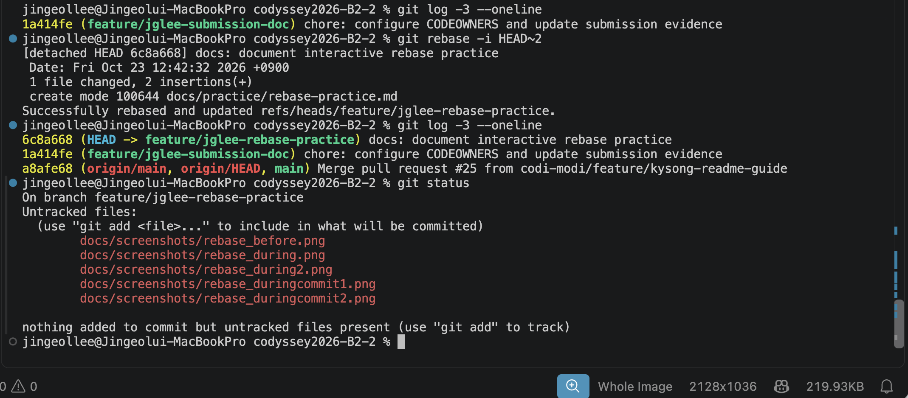

| 비교 항목 | 정리 전 | 정리 후 |
| --- | --- | --- |
| 기준 커밋 이후 커밋 수 | 2개 | 1개 |
| 커밋 해시 | `6ebf3dc`, `67f0552` | `6c8a668` |
| 메시지 | 제목 추가 / 목적 설명으로 분리 | `docs: document interactive rebase practice` |
| 파일 내용 | 제목과 설명, 총 2줄 | 같은 2줄 유지 |
| 기준 커밋 | `1a414fe` | `1a414fe` 유지 |

증빙 정리 시 로컬 커밋 객체를 대조한 결과:

```bash
git rev-list --count 1a414fe..67f0552
# 2
git rev-list --count 1a414fe..6c8a668
# 1
git diff --exit-code 67f0552 6c8a668 -- docs/practice/rebase-practice.md
# 출력 없음, 종료 코드 0: 파일 내용 동일
```

현재 reflog에서도 `rebase (start)`, `rebase (squash)`, `rebase (finish)`를 확인했다. 정리 후 `git status`의 untracked 항목은 캡처 이미지이며, rebase 실패나 미해결 충돌을 뜻하지 않는다. 원본 텍스트에 생략된 todo·메시지 편집 과정은 위 스크린샷으로 보완한다.

### 왜 이 방법을 선택했는가 및 주의할 점

- 같은 목적의 연속 커밋을 하나로 합쳐 리뷰어가 문서 변경의 의도를 한 번에 파악하도록 했다.
- squash는 파일 내용을 보존하면서 새로운 커밋을 생성하므로 커밋 해시가 바뀐다. 변경 전 커밋은 현재 브랜치 이력에서 빠지지만 당분간 reflog·로컬 객체로 확인할 수 있다.
- 원격에 push하기 전 개인 브랜치에서 수행했으며, 원본 로그에는 push나 강제 push가 없다. 공유 `main` 이력을 재작성하지 않았다.
- 이 증빙은 로컬 실습 완료 기록이다. 해당 브랜치의 원격 push·PR 병합 완료를 뜻하지 않는다.
